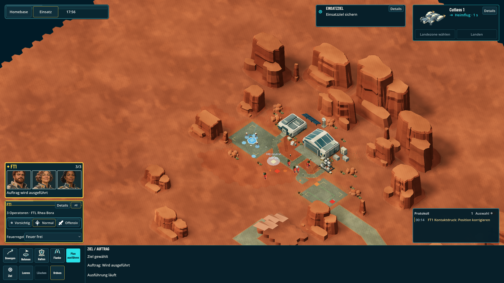
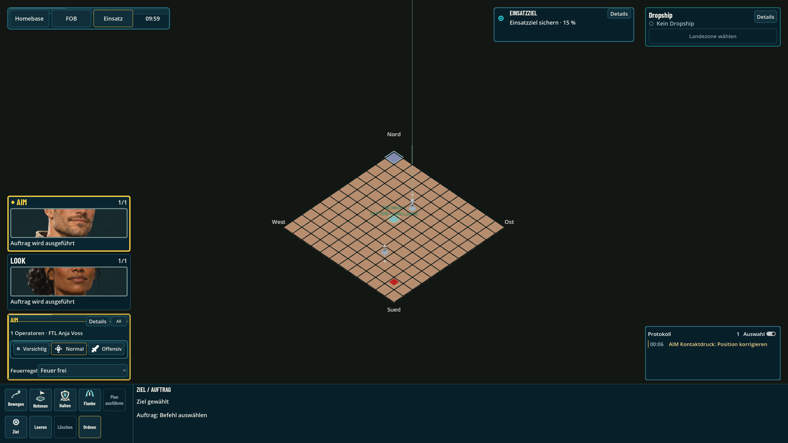
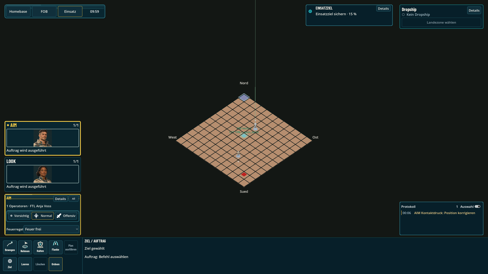
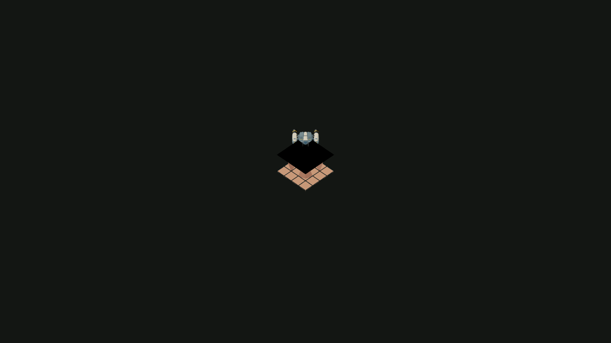
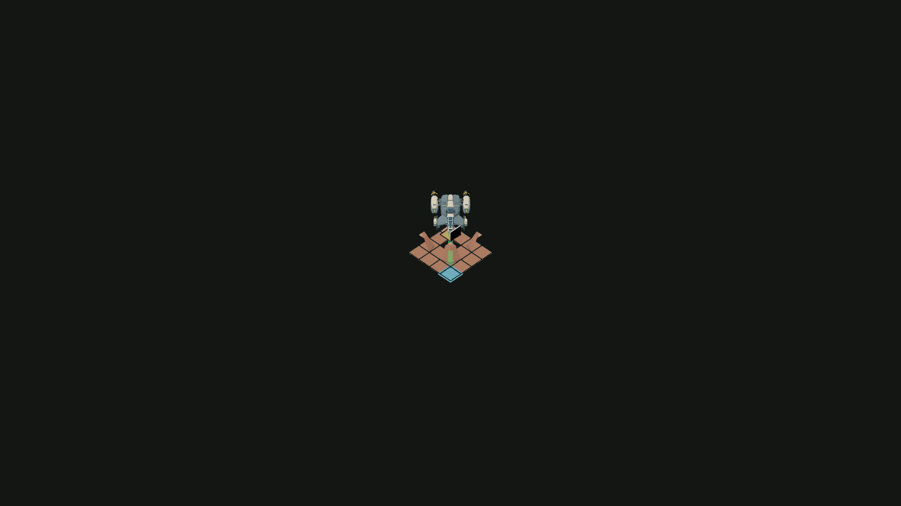

# Befehlsruckler und Alt-Gates – 05.11.2026

Die synchronen Move-/GO-Kosten sind im vergleichbaren ersten Dreierlauf um
**63,2 %** gesunken. Eine allgemeine Verbesserung der Framezeiten ist dadurch
**nicht belegt**: Im ersten 38-Sekunden-Fenster sind Median und p95 schlechter.
Der normale 90-Sekunden-Lauf besteht 61/61; ein HUD-Resthitch bleibt offen.
Main-Integration und Main-Smoke werden separat in [main_receipt.json](main_receipt.json)
bestätigt. Im eingefrorenen Archiv bleibt diese Receipt PENDING; der aktuelle
Status steht in der separaten `main_receipt.json` neben dem Archiv.

Basis: `01ab595a7b89632629eee0ad3523281e542148a0`, Branch
`task/continue-perf-legacy-20261105`. Dieses neue Paket verändert keine früheren
QA-Pakete, Roster oder Assets. Alle kopierten Rohdaten und Bilder sind bytegleich.

## Befehlsarbeit und normaler nativer Lauf

Vorher wurden schwere HUD-Flächen innerhalb derselben Move-/GO-Folge mehrfach
erneuert. Jetzt erscheinen Befehle und kompaktes Feedback weiterhin synchron;
schwere abgeleitete Flächen werden im vorhandenen UI-Takt zusammengeführt.
Ein dazwischenliegender Transportpass übernimmt ausstehendes Command-Force,
damit weder ein Update verloren geht noch ein zweiter Flush nötig wird.
Simulation, Autorität, Befehlsersetzung und Ausführung bleiben synchron.

Die drei gleichen frühen Befehlszeitpunkte liegen bei ungefähr 12, 24 und 36 s:

| Synchrone Move+GO-Paarzeit | Vorher, 38-s-Lauf | Final, erste 38 s |
|---|---:|---:|
| Paar 1 | 215,350 ms | 76,036 ms |
| Paar 2 | 215,291 ms | 74,582 ms |
| Paar 3 | 256,692 ms | 102,280 ms |
| Mittel dieser drei Paare | 229,111 ms | 84,299 ms |

Alle sieben finalen Move- und GO-Aufrufe wurden akzeptiert. Ihre Paarzeiten
liegen zwischen **74,582 und 103,736 ms**. Der 38-s-Batchinglauf im Paket ist
ein Zwischenstand; er ersetzt den späteren finalen Lauf nicht.

Für den getrennten Framevergleich wurden nur Frames mit Endzeitpunkt
`0 <= elapsed_usec <= 38_000_000` ausgewählt. Die vollständigen 90-s-Quantile
werden nicht kausal gegen die vollständigen 38-s-Quantile verglichen.

| Erstes 0–38-s-Fenster | Vorher | Final |
|---|---:|---:|
| Frames | 1250 | 1137 |
| p50 / p95 | 26,777 / 68,007 ms | 29,730 / 77,072 ms |
| p99 / Maximum | 152,063 / 309,861 ms | 140,957 / 288,544 ms |
| Frames über 100 / 250 ms | 28 / 3 | 34 / 1 |

Die Auswahl endet tatsächlich bei 37,984 s; Quantile nutzen Nearest Rank.
[analysis.json](analysis.json) und [Analyseskript](analyze_performance.py)
machen die Ableitung aus den unveränderten Frame-JSONs wiederholbar.
Ein Lauf je Bedingung belegt keine allgemeine Verteilung oder Kausalität.

Der **normale** finale Lauf verwendet 2560×1440, Vollbildmodus 3, Vulkan
Forward+, 1×: 3551 Frames in 90,014 s, Simulations-/Wandzeit 0,993735.
p50/p95/p99/Maximum: **19,915 / 63,280 / 125,908 / 288,544 ms**.
Der Motiontrace enthält 341 Proben. Dieselben drei fitten Spielerunits bewegen
sich auch im Fenster 85–90 s weiter; keine Actor-/Positionspatches.
Es bleiben 62 Frames über 100 ms und einer über 250 ms. Der Resthitch bei
36,589 s korreliert mit 204,3 ms vollständigem HUD-Update, davon 144,1 ms
Runtimeflächen; deren innere Flächen beanspruchen 78,9 ms, weitere rund
65,2 ms entfallen auf den zusätzlichen Legacy-Matrixpfad. Daraus folgt keine
ruckelfreie FPS-Abnahme. Keine weitere Produktänderung wurde dafür vorgenommen.

## Sieben Alt-Gates und der zusätzliche Karten-Oracle

| Gate | Einordnung / aktuelle Prüfung |
|---|---|
| TASK111 | Aktueller DEF-Vertrag statt automatischer Overwatch; 32/0. Legacy-Opt-in nur synthetisch. |
| TASK113 | Flank bleibt standardmäßig aus; explizite Integrationsfixture; 30/0. |
| TASK468 | Queue und autoritativen Physics-Commit getrennt geprüft; 23/0. Kein Corepatch daraus. |
| TASK436 | A5-Porträts und aktives Parentprofil ersetzen die alte Coveragebar-Annahme; 59/0. |
| TASK401 | Gemeinsame Richtungsquelle und echte Kartenrechtecke; Headless 125/0, final nativ 135/0. |
| Firesector | Stehendes Facing, Bewegung, Scan, Kontakt und FireEvent priorisiert; 49/0. |
| TASK230 | Getrennte Air-/Surface-Freigabe pro Owner und FoW-Invalidierung; Headless 127/0, nativ 155/0. |

Die erhaltene große Headlessmatrix bleibt **26/27**, mit TASK344 allein wegen
der historischen 48×48-Annahme rot. Der aktuelle Vertrag verlangt 96×98 echte
Hexfelder. Nur dieses feste Oracle wurde berichtigt; der fokussierte Nachlauf
besteht **40/0**. Das wird nicht als neu ausgeführte 27/27-Gesamtmatrix verkauft.
Der separate abschließende Source-Gate besteht ebenfalls 40/0.

Beim Facing wurden widersprüchliche Richtungsquellen vereinheitlicht; ein
wiederholter Visualsync liest das vorhandene autoritative Bewegungsfacing.
Beim Air-Pfad bleiben eigene Planmarker in `known_terrain` vor der Erstlandung
sichtbar, fremde/neutrale Surface-Marker benötigen Tilesicht. Blackout bleibt
streng. Ein gemischter Parent versteckt keine einzeln erlaubten Kinder mehr.
Die interleavte HUD-Regression besteht 40/0. Das unabhängige scoped Review ist
APPROVED; es ist keine allgemeine Spiel- oder Releaseabnahme.

## Kontrollierte native Fixturebilder und Porträtkorrektur

Die folgenden Facing-/Air-Aufnahmen sind **kontrollierte Fixtures**. Sie
belegen die Darstellung im nativen Viewport, keinen natürlichen Schusswechsel,
Treffer oder normalen Missions-/Deploy-Ablauf. Synthetische Contact-/FireEvents
werden nicht als physischer Combatnachweis ausgegeben.

| Einzelporträt vorher | Nach reiner Darstellungszeile |
|---|---|
|  |  |

Die Bilder wurden geöffnet: Vorher fehlen Augen/Stirn, nachher bleibt der Kopf
vollständig. Nur `COVERED` wurde auf `KEEP_ASPECT_CENTERED` geändert.

| Blackout, unbekannt | Eigene Planung auf bekanntem Terrain |
|---|---|
|  |  |

## Quellenbindung, Erhalt und Abschlussgrenze

Der historische Pin enthält 24 049 Dateien **vor** den letzten Änderungen.
Die alten Overlayverzeichnisse sind Junctions, keine unveränderlichen
Sourcesnapshots. [final_source_binding.json](binding/final_source_binding.json)
bindet 1948 aktuelle Codepins und genau drei spätere Deltas: die Porträtzeile,
das TASK344-Oracle und Sourcepin-Unterstützung im Prüfrunner. Byteweises
Zurücknehmen der Porträtzeile reproduziert exakt den gemessenen Controller
`d24fae1e…`. Dessen vollständige Originalbytes liegen im Paket.

Der 90-s-Lauf misst damit denselben Command-/Tick-/Batchingcode vor dieser
reinen Porträtdarstellung. Der aktuelle Controller ist `144b88b2…`, der View
`469e5d79…`. Das spätere Source-Gate protokolliert identische Vorher-/Nachher-
Hashes für acht kritische Dateien. Assets, Szenen, Maps, Daten und Shader
wurden in dieser Fortsetzung laut Root nicht geändert.

Der Erhaltcheck meldet **38 fremde Dateien und 437 vorherige Rosterdateien**
ohne Abweichung. Originaltests, Vorhercontroller, gemessener Controller,
REDs, Zwischenstände und Rohdaten bleiben erhalten. Große Frame-/Motion-JSONs
sind direkt im portablen ZIP enthalten, ohne zusätzliche unkomprimierte Kopie
im schlanken Ordner. Maincommit und Smoke folgen separat in der Receipt.

Keine allgemeine FPS-, Release-, EXE-, LAN-/WAN- oder stilistische Nutzerabnahme.
