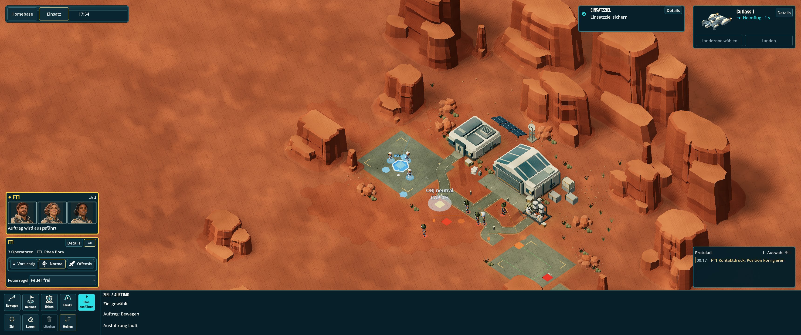

# CPU/HUD R5: weniger redundante Aufbereitung bei gleicher Darstellung

08.11.2026. Basis Main33bc504c4; Arbeitsbranch codex/cpu-hud-r5-20261108.
Bewusste Fortsetzung des integrierten R4 statt des aelteren Integrationszweigs.
Main ist integriert. Der getestete Commit
`a29a1262a8ad1427a0a704c38a096783eec4fc48` wurde normal gepusht und der
exakte Remote-HEAD bestaetigt. [Mainquittung](main_receipt.json).

## Ergebnis / Problem / Ursachen

Drei belegte CPU-Redundanzen sind entfernt. Die primaere HUD-Phase zeigt in
zwei normalen Nachlaeufen rund16–18% geringere P95-Zeiten. Grafikqualitaet,
Gameplay, Quellfrische und bestehendes Scheduling bleiben erhalten. Einzelne
lange Frames bleiben; dies ist keine Ruckelfreiheits- oder Releaseabnahme.

1. Full-/Light-HUD wertete unveraenderliche Startargumente wiederholt aus:
   2002 Aufrufe in5 Fullrefreshes, im engen Test1063 bei4 Full-/Lightaufrufen.
   Jetzt einmalige Prozesskonfiguration pro Controllerleben, defensiv kopiert.
   Explizite Argumentauswertung und vorrangige Live-Peerzuordnung bleiben.
   Kein Mission-/Unit-/Runtime-State wird dadurch gecacht.
2. Kompakte Contact-/Playerdecision-Returns verwarfen zuvor bereits gebaute
   ausfuehrliche Statuszeilen. Die vier Execution-/Movement-/Security-/Flank-
   Formatter laufen jetzt nur noch im wirklichen Fallback. Voller RAWtext und
   Playerdecision-Snapshot stimmen mit einem eingefrorenen Originaloracle
   ueberein. Die Playerentscheidung wird weiterhin vor den Returns gesetzt.
3. Interaktionsbindings parsten pro5 Fullrefreshes195-mal Szenariodaten.
   Der bestehende Helper haelt jetzt nur den Parse genau eines bytegleichen
   Textes bis1MiB UTF-8. Jede Abfrage liest die Datei weiterhin und baut die
   aktuellen Runtime-/Map-/Markerbindungen neu. Keine mtime-/Hashannahme,
   kein Cache fertiger Runtime-Snapshots, kein weggelassener Dateizugriff.
   Neue Inhalte gleicher Laenge, Nicht-Objekt-JSON und grosse Dateien bleiben
   frisch; uebersetzte/private Rohdictionaries verlassen den Normalpfad nicht.

Produktdateien: mission_tactical_sandbox_controller.gd und
mission/mission_interaction_point_binding.gd. Dazu drei Verifier, eine reine
Komponentenprobe, neuer Pinrunner/Packager,83-Gate-Manifest und Dokumentation.
[Task](../../tasks/CPU_HUD_R5_2026_11_08.md),
[Contract](../../dev/mission_hud_projection_authority_contract.md) und
[unabhaengiger Sourcereview](../../reviews/CPU_HUD_R5_2026_11_08_review.md).

## RED/GREEN und Grenzen der Komponentenmessung

Identity33/2 ->35/0; Status18/2 ->20/0; Scenario-Parse sauberer RED18/1
->23/0, anschliessend28/0 einschliesslich UTF-8-/Empty-Dictionary-Grenzen.
Die eingefrorenen Originalproduktdateien stimmen bytegenau mit Main33bc504c4
ueberein und liegen im Roharchiv. Frische Gesamtmatrix83/83, Exit0/errors0,
private Profile/Canarys und stabile Sourcepins in jedem Fall.

Der erste Parse-Verifier hatte einen Test-API-Parserfehler. Der zweite
Negativversuch mit malformed JSON erzeugte erwartete JSON.parse_string-
Enginefehler und ist kein fehlerfreier GREEN. Beide Versuche bleiben erhalten.
Der saubere Verifier nutzt gueltiges Nicht-Objekt-JSON; fehlerhafte JSONtexte
werden vom Produkt weiterhin erneut geparst statt deren Fehler zu cachen.
Der gezielte Statusverifier erzwingt keinen separaten nichtleeren Contact-Fire-
Primaryfall. Bestehende Kontakt-/Visual-/Authoritygates bleiben eigene Nachweise.

Komponentenzeit ist keine native FPS: Nach Identity sinkt deren inklusiver
5-Full-Anteil von9.981 auf4.053ms. Mit echter GM01-Szenariodatei sinkt der
inklusive Bindinganteil nach Parsefix69.075 auf62.476ms; die gesamte
5-Full-Messung wird dabei jedoch schlechter364.710 ->422.041ms. Dieser
Gegenbeleg bleibt. Verschachtelte Zeiten werden nicht addiert; kein Gewinn
der ganzen HUD-Projektion wird allein aus diesen synthetischen Zeiten abgeleitet.

## Normale native90-s-Vergleiche

Godot4.6.2,3440x1440 echtes Vollbild, Vulkan/Forward+, Kamera22,1x,
VSync1,240Hz, Physik60/max8. Gleiche Route, elf Runtime-Units und sieben
angenommene Move/GO-Paare je Fenster. Fokus durchgehend, Kamera unveraendert.
Keine Actor-/HP-/Timer-/Fuel-/Positionspatches, keine Qualitaets-/Sichtweiten-
oder Arbeitskadenzreduktion. Keine parallelen eigenen Audits in Messfenstern.

|90s-Serie|Frames|p50/p95/p99 ms|Max ms|>50/>100/>250ms|Sim/Wand|
|---|---:|---|---:|---|---:|
|Vorher 20261108T141244Z-527f445b|2429|35.946/81.726/109.544|177.367|741/41/0|0.999614|
|Nachher A 20261108T143544Z-d0fe595b|2651|33.793/71.709/89.123|160.657|649/17/0|0.999706|
|Nachher B 20261108T143838Z-59bbe9b9|2729|31.820/70.414/96.916|169.312|635/24/0|1.000168|

Alle drei68/0, Exit0/errors0, Source-/Roster-/Privatprofilguards gruen.

|Primaere HUD-Phase|P95 ms|Max ms|Samples|Max Startalter ms|
|---|---:|---:|---:|---:|
|Vorher|40.494|46.373|86|87|
|Nachher A|33.098|38.089|85|57|
|Nachher B|33.945|38.831|87|49|

Maximal ein periodischer Job pro Engineframe in allen Fenstern. Navpendingmax0,
Effectqueuemax0, Commandqueuemax7;7–8 Catchupticks pro Frame. Kein Beweis
allgemein dauerhaft leerer Queues oder einer festen Frameobergrenze.
Phasen werden nicht ausgelassen; ihre Anzahl schwankt mit dem bisherigen
Scheduling und den echten Commands. RAW-/Owner-/Force-/Lifecycle-Nachbarn
sind in der aktuellen Matrix erneut gruen.

SteelDivision2 lief weiterhin; der Nutzer hatte Fortsetzung unter Fremdlast
ausdruecklich gewaehlt. Die Last ist nicht kontrolliert konstant. Die neueren
Serien sind deutlich schneller als die vorherigen R4-Lastserien, selbst der
frische Vorlauf ist schneller. Deshalb sind diese GPU-/Systemaenderungen
kein R5-Produktgewinn. Die obigen CPU-Phasenwerte sind wiederholte beobachtete
Teilkostengewinne, keine isolierte gesamte FPS-/CPUkausalitaetsgarantie.

## Native Bilder / Erhalt / Integration

Root hat Original-Vorher und Nachher-B geoeffnet: gleiche Mission/Kamera,
menschliche Figuren, HUD und aktueller Bewegungsauftrag erhalten. Die Bilder
liegen nach dem Messfenster und beweisen keine kontinuierliche Framerate.
[Vorher](captures/before_go_movement.png), [Homebase](captures/02_homebase.png).

[Manifest](manifest.json), [gebundene Quellen](source_binding.json),
[Original-Rohdaten](raw_evidence.zip), [Schutzpruefung](preservation_report.json).
Originalschutz1415 Dateien/502 Roster/echter Roster sowie2154 zusaetzliche
Startdateien werden einschliesslich SHA256/Groesse/mtime geprueft. Alte QA-
Pakete und fremde WIP bleiben erhalten. Kein Reset/Clean/Stash/Restore.
Package-PASS ist Bytes-/Quellen-/Guard-/Schutzbeleg, keine Leistungsfreigabe.

Implementierung ausschliesslich im Taskbranch; kontrollierter Fast-forward
auf Main. Frischer privater nativer90-s-Main-Smoke:
`cpu_hud_r5_main_smoke/20261108T144552Z-a07b5290`,68/0, Exit0/errors0,
Source-/Canary-/Rosterguards gruen. Alle2359 gebundenen Sourcehashes stimmen,
alle23 alten R4-QA-Dateien sind bytegleich. Auch der gesamte urspruengliche
und zusaetzliche2154-Dateien-Schutz bleibt einschliesslich mtimes gruen.

Main:2635 Frames, P50=33.895ms, P95=70.589ms, P99=93.238ms, Max167.485ms;
659/19/0 Frames ueber50/100/250ms, Sim/Wand1.000230. Primaere HUD-P95
36.939ms, Max40.633ms,84 Samples. Das liegt ebenfalls unter dem Vorlauf,
zeigt aber die Streuung: Die16–18% der beiden Tasknachlaeufe sind keine feste
Garantie. Quellen, Qualitaet und Gameplay bleiben gleich; Fremdlast bleibt.

Originalbild des Main-Smokes geoeffnet, in `captures/main_smoke.png` erhalten.
Sechs Original-JSON-/Logdateien mit Streamingreadback in `main_smoke_raw.zip`.
Die Quittung enthaelt die gepruefte Mainquelle und den bestaetigten ersten
Remote-HEAD. Der anschliessende Nachtrag entsteht auf
`codex/cpu-hud-r5-main-receipt-20261108`, aendert nur Doku/Evidence und wird
ebenfalls per Fast-forward integriert, normal gepusht und danach gegen den
finalen Remote-HEAD geprueft. Kein Produktdelta nach Main-Smoke.
Keine EXE-/WAN-/Releaseaussage.
