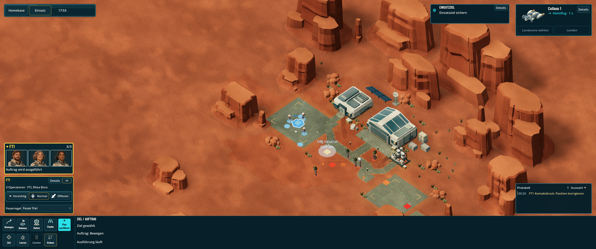

# CPU/HUD R6: weniger wiederholte Use-State-Aufbereitung

08.11.2026. Basis Main320e3b57e; Branch codex/cpu-hud-r6-20261108,
bewusste Fortsetzung des integrierten R5. Per Fast-forward auf Main integriert;
getesteter Commit32d6a708d65e16f1ce99b98a4943dcb8bb4f74b0 gepusht und
exakt remote verifiziert. [Main-Quittung](main_receipt.json).

## Ergebnis / Ursache / Aenderung

Ein belegter CPU-Hotpath ist enger gefasst: Ein Light-HUD-Aufruf baute
denselben Interaktions-Use-State-Kontext siebenmal auf, ein Full-Aufruf27-mal.
Jetzt laeuft der unveraenderte Producer einmal pro synchroner ReadModel-
Generation. Alle oeffentlichen Abfragen bleiben erhalten, mit tief kopierten
vollstaendigen Payloads. Die native primaere HUD-P95 ist in beiden Nachlaeufen
niedriger. Die gesamten langen Frames sind dadurch **nicht beseitigt**;
die schlechtere196-ms-Spitze und die leicht schlechteren Gesamt-P99 bleiben.

Produktdelta genau acht zusaetzliche Controllerzeilen: vorhandenes
MissionHudReadModel.project mit spezifischem Use-State-Key; Originalbody
unveraendert als uncached Producer. ReadModel, Scheduler, Budgets, Renderer,
Grafikqualitaet und Gameplay sind unveraendert. Ausserhalb des Passes, nach
Ende/Frame-/Revisionswechsel und bei rekursiven Produzenten werden Quellen
weiter frisch gelesen. Eine entwertete Generation wird nicht neu befuellt.
Objective-Gate und Use-Intent sind ausdruecklich nicht gecacht; keine neue
Runtime-Autoritaet und keine zwischen Jobs gehaltenen Runtime-Snapshots.

[Task](../../tasks/CPU_HUD_R6_2026_11_08.md),
[Contract](../../dev/mission_hud_projection_authority_contract.md),
[unabhaengiger Review](../../reviews/CPU_HUD_R6_2026_11_08_review.md).
Neue Dateien: ein Verifier fuer zwei Fixtures,91-Gate-Manifest, Pinrunner,
reiner Packager und Task-/Review-/QA-/Statusdokumentation.

## RED/GREEN / Paritaet / Komponentenmessung

Sauberer RED17/3, errors0: alle alten Payload-/Freshness-/Ownerpraedikate
bestanden, genau die drei wiederholten Aufbauzaehler waren rot.
GREEN20/0, authored Frontier21/0, UIparitaet24/0. Finale Default-/Frontier-
Fixtures jeweils26/0: nichtleere/leere echte Bindings, alle vier authored
Labelsinks, volle RAWs/Tooltips/GO-Policy, Originalproduceroracle und tiefe
Rueckgabemutation. Tick/Queues/Actors bleiben synchron unveraendert.
Originalcontroller im Roharchiv ist bytegleich mit Main320e3b57e.

Die aktuelle Gesamtmatrix besteht **91/91**, errors0, private Canarys,
Roster und stabile Sourcepins. Zusatznachbarn pruefen Use-State, Feedback,
Intent, Fortschritt, Objective-Gate und Visual-State. Das Source-Review
findet keinen Blocker. Grenze: Ein realer Interaction-Command-Callback
waehrend eines aktiven gecachten HUDpasses wird im neuen Verifier nicht
injiziert; bestehende Command-/Authority-/Reentrygates ergaenzen den Nachweis.

|5 echte Komponentenrefreshes|Vorher|Nachher|
|---|---:|---:|
|Light: oeffentliche Use-State-Reads|35|35|
|Full: oeffentliche Use-State-Reads|135|135|
|Light: Bindingaufbauten|50|20|
|Full: Bindingaufbauten|195|65|
|Light: gesamte synthetische Zeit ms|54.192|47.563|
|Full: gesamte synthetische Zeit ms|354.236|341.781|

Inklusive Use-State-Anteile Light15.606 ->3.263ms und Full54.986 ->4.160ms.
Diese verschachtelten Zeiten sind nicht additiv und kein nativer FPSbeweis.
Die Ausgabe wird weiter vollstaendig projiziert; nur redundant abgefragte
Quellaufbereitung im selben synchronen Pass entfaellt.

## Normale native90-s-Serie

Godot4.6.2,3440x1440 Vollbild, Vulkan/Forward+, Kamera22,1x, VSync1,
240Hz, Physik60/max8, Ryzen7800X3D/RTX4070TiSUPER. Gleiche normale Route,
elf Runtime-Units und sieben akzeptierte Move/GO-Paare je Fenster. Fokus
durchgehend, Kamera unveraendert. Keine Actor-/HP-/Positions-/Timer-/Fuel-
Patches, Qualitaets-/Sichtweiten-/Kadenzreduktion oder parallele eigene Audits.

|90s|Frames|p50/p95/p99 ms|Max ms|>50/>100/>250ms|Sim/Wand|
|---|---:|---|---:|---|---:|
|Vorher 20261108T174948Z-2e13263a|830|104.234/145.793/152.130|165.340|828/669/0|0.995128|
|A 20261108T181144Z-8b93008f|987|101.994/141.296/152.656|196.071|829/579/0|0.997535|
|B 20261108T181429Z-98dfd6f1|840|103.907/143.823/155.048|168.971|838/646/0|0.996975|

Alle68/0, Exit0/errors0, private Profile, Source-/Roster-/Markerchecks gruen.

|Primaere HUDphase|P95 ms|Max ms|Samples|Max Startalter ms|
|---|---:|---:|---:|---:|
|Vorher|32.499|33.719|76|276|
|A|26.825|29.200|79|209|
|B|28.643|31.117|78|157|

Maximal ein periodischer Job pro Renderframe in allen Serien. Navpendingmax0,
Effectqueuemax0, Commandqueuemax7, bis8 Physikticks pro Frame. Kein Beweis
allgemein leerer Queues oder fester170-ms-Obergrenze. Move+GO-Paare kosten
im Median71.904 ->74.497/74.361ms, maximal84.156 ->83.479/98.440ms;
ein gesamter Commandkostengewinn ist damit nicht belegt.

Die196.071-ms-Spitze liegt nahe dem12-s-Commandpaar mit36.963ms Move und
39.070ms GO; nahe Fogowner31.202ms, Controllerprocess1.153ms und
Engineprocess73.612ms. Versetzte/verschachtelte Scopes sind keine additive
komplette Timeline. In B bleibt ein54.318-ms-Ausfuehrungsupdate beobachtet.
Diese Restkosten werden nicht als durch den Use-State-Fix geloest ausgegeben.

## Zusaetzliche GPU-/Framegrenzendiagnose

Unveraenderter vorhandener GPUharness, gesondert instrumentiert; **keine
faire FPSbaseline**. Lauf20261108T181919Z-f11ab0a5 besteht70/0, Exit0/
errors0,936 passende In-window-Pre/Post-Grenzen, kein Ringverlust. Karten-
GPU Median73.386/P99=75.156/Max80.577ms, Root-GPU Median0.096ms/Max36.712ms.
Pre->Post-Wandintervalle Median23.321/P99=104.484/Max116.338ms. Postprobe
max166us; Displayfacts187–757us, kein belegter Displayfacts-Hitch.

Ein181.008-ms-Diagnoseframe enthaelt ein beobachtetes114.689-ms-Pre/Post-
Wandintervall; nahe zuletzt gelesene Karten-GPU16.474ms. Das Matching benennt
eine beobachtete Engineframegrenze, keine garantierte GPUframeidentitaet.
Warte-/Present-/OS-/GPUanteile bleiben unvollstaendig zugeordnet. Positive
Werte und lange Intervalle begruenden keinen spekulativen Render-/OSpatch.
Root-/Kartenwerte und CPUscopes werden nicht addiert. Originale und kleine
Auswertung bleiben erhalten. Beide Viewporttimer und Handler werden beendet.

SteelDivision2 lief weiter; die zuvor ausdruecklich autorisierte Fremdlast
ist nicht kontrolliert konstant. Diese Serien sind nicht als isolierter
Vergleich zu den schnelleren R5-Serien verwendbar. Nur die neue gleichartige
R6-Serie und die exakten Counter-/Oraclebelege tragen den begrenzten Befund.
Keine allgemeine FPS-, Ruckelfreiheits- oder Releaseabnahme.

## Native Sicht / Erhalt / Integration

Original-Vorher und Nachher-B geoeffnet: gleiche Mission/Kamera/HUD und
menschliche Figuren erhalten. Aufnahmen nach dem Messfenster sind keine
kontinuierliche Framerate- oder gestalterische Nutzerabnahme.
[Vorher](captures/before_go_movement.png), [Homebase](captures/02_homebase.png).

[Manifest](manifest.json), [Sourcebindung](source_binding.json),
[Original-Rohdaten](raw_evidence.zip), [Schutz](preservation_report.json).
Originalschutz1415 Dateien/502 Roster/echter Roster sowie2337 zusaetzliche
Startdateien bleiben einschliesslich SHA256/Groesse/mtime geprueft. Alte
QA-Pakete und fremde WIP bleiben. Kein Reset/Clean/Stash/Restore.
Paket-PASS ist Bytes-/Quellen-/Guard-/Schutzbeleg, keine Leistungsfreigabe.

Implementierung im Taskbranch, danach kontrollierter Fast-forward auf Main.
Frischer privater nativer90-s-Main-Smoke20261108T182549Z-45dfd237:68/0,
Exit0/errors0;2751 Frames, p50/p95/p99=32.270/68.505/90.934ms,
Max136.247ms. Primaere HUD-P95=26.626ms, Max29.620ms,86 Samples.
Tatsaechliche Aufnahme geoeffnet: Mission/HUD/Figuren erhalten.
Der schnellere Gesamtlauf ist bei schwankender Fremdlast kein kontrollierter
Leistungsbeweis und widerlegt die196.071-ms-Nachlaufspitze nicht.

2362 gebundene Quellen stimmen per SHA256 mit dem geprueften Stand ueberein;
34 alte QA-Dateien sind bytegleich mit Basis Main320e3b57e. Alle Schutzchecks
weiter gruen. Getesteter Maincommit32d6a708d65e16f1ce99b98a4943dcb8bb4f74b0
normal gepusht und exakt gegen refs/heads/main verifiziert. Dieser Nachtrag
enthaelt nur Doku/Belege, kein Produktdelta nach Main-Smoke. Abschluss-HEAD
wird nach dem Nachtrag erneut remote geprueft. Kein EXE-/WANumfang.
[Main-Rohdaten](main_smoke_raw.zip), [Mainaufnahme](captures/main_smoke.png).
