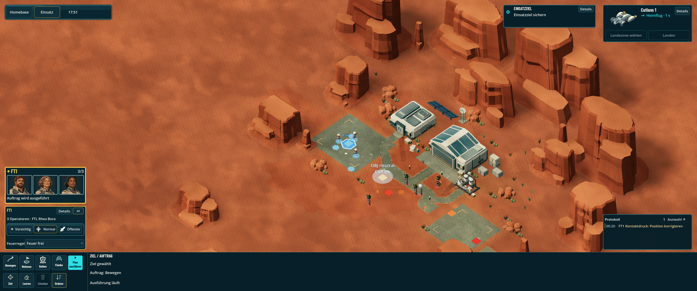

# CPU/Fog R7: doppelte LOS-Reichweitenrechnung entfernt

08.11.2026; Basis Maind77a37422d0f3227fff1e4550310d28fdc3297fa.
Branch codex/cpu-hud-r7-20261108, bewusste Fortsetzung des integrierten R6.
Mainintegration, frischer Main-Smoke, Push und Remotequittung folgen separat.

## Problem / Ursache / Aenderung

Die historischen R6-Spitzen bis196.071ms bleiben unvollstaendig zugeordnet.
Frische R7-Baseline reproduziert sie nicht; ihre groesste Framezeit91.517ms.
Der Source-/CPUaudit begruendet keinen weiteren Patch in Propertyabfragen oder
Runtimeindex-Bindung. Details, auch der erste fehlerhafte Auditoverride und
sein korrigierter Nachlauf, bleiben im Rohpaket erhalten.

Belegter enger LOS-Hotpath: zugelassene Punktabfragen mit Registry prueften
identische Reichweite im Punkt- und Terrain-Einstieg. Jetzt delegiert der
Punkt-Einstieg bei Registry direkt an den unveraenderten vollstaendig
geguardeten Terrain-Einstieg; ohne Registry bleibt er selbst geschuetzt.
Dessen Guard lehnt vor Traversierung ab, Grenzen und Distanzfunktion gleich.
Kein Cache, keine Sichtweiten-, Occlusion-, Qualitaets-, Gameplay-, Budget-,
Kadenz- oder Actorreduktion. Fog-vorgelagerter Rangeguard bleibt unveraendert.
Produktdelta nur5 hinzugefuegte/5 entfernte Zeilen in scripts/core/los_system.gd.

Direkte Terrainentry bleibt komplett; negative Reichweite unbegrenzt. Der
virtuelle Terrain-Einstieg wird jetzt auch bei abgelehnter Punktabfrage
aufgerufen. Vorhandene Overrides sind Testinstrumentierung und delegieren
an super; kein produktiver Override gefunden. Keine neuen Owner/Mutationen.

[Task](../../tasks/CPU_HUD_R7_2026_11_08.md),
[Contract](../../dev/fog_of_war_modes_contract.md),
[unabhaengiger Review](../../reviews/CPU_HUD_R7_2026_11_08_review.md).
Neue Audit-/Verifier-/Manifest-/Pinrunner-/Packagerdateien plus Dokumentation.

## Nachweis / Regression

Sauberer RED30/2, errors0: exakt beide doppelten Aufbauzaehler rot.
GREEN32/0; erweitert48/0 in der finalen92/92-Gesamtmatrix, errors0.
Frozen Originalpointbody entspricht Baseblob; originaler Terrainbody bleibt
unveraendert. Original-LOSbytes liegen im ZIP. Square/Hex, exakte/benachbarte
Reichweitengrenzen, negative/Nullwerte, Runtimeblocker offen/zu/wieder offen,
Wrapper und Nullobserver, ganze mehrteilige Full-/Dirty-Fogjobs mit7er-Slices,
exakte Fortschrittsmetadaten und atomare volle Team-/Delta-Publikation gleich.
Quelle und Registryrevision bleiben beim Lesen erhalten. Bestehende Nachbarn
pruefen zusaetzlich Tuerautoritaet, Fog512-Budget und sichtbare Darstellung.

|2560 zugelassene echte LOSqueries je Fixture|Original|R7|
|---|---:|---:|
|Rangeberechnungen|5120|2560|
|Hex Gesamtzeit ms|66.444|59.394|
|Square Gesamtzeit ms|47.055|37.286|

Ein begrenztes serielles Paar, kein signifikanter nativer Leistungsbeweis.
Auch in den echten Full-/Dirty-Fogjobs halbieren sich nur die LOS-eigenen
Rangeberechnungen. Quellaufbereitung, Fog-Rangeguard und Traversierung bleiben.
Unabhaengiges Source-/Testreview ohne Blocker. Geerbter R4-Testhelfer und
TerrainTileData sind keine eigenen R7-per-case Pins; separate Basebytebindung
in dependency_binding.json und volle Paketinventur pruefen diese zusaetzlich.
R4-Helper wird in derselben Matrix separat ausgefuehrt. Kein verdeckter
Anspruch auf transitive Absicherung allein durch die per-case Pins.

## Normale native90-s-Vollbildserie

Godot4.6.2/3440x1440/Vulkan/Forward+/Kamera22/1x/VSync1/240Hz/Physik60,max8.
Ryzen7800X3D/RTX4070TiSUPER. Gleiche normale Route,11 Units und7 akzeptierte
Move/GO-Paare; Kamera/Fokus stabil, keine privaten Gameplaypatches. Nur Root
seriell; eigene Audits waehrend Messfenstern pausiert. Vorher-/Nachherbilder
geoeffnet: gleiche Mission, HUD und menschliche Figuren erhalten; keine
kontinuierliche Pixel-/Framerate- oder gestalterische Nutzerabnahme.

|90s|Frames|P50/P95/P99 ms|Max ms|>50/>100/>250ms|Sim/Wand|
|---|---:|---|---:|---|---:|
|Frische Baseline|5964|11.853/35.579/47.476|91.517|45/0/0|0.999832|
|R7 A|795|111.695/157.500/161.756|167.322|763/631/0|0.977925|
|R7 B|813|110.984/158.836/167.445|179.189|752/592/0|0.974434|
|Mainbaseline-Kontrolle nach R7|1084|92.869/154.675/163.873|181.623|769/469/0|0.984051|

Alle68/0, Exit0/errors0, Source-/Roster-/Marker-/Isolationsguards bestanden.
Kontrolllauf nutzt explizit Basecommitd77a37422 per privatem scripts/data-
Gitarchivoverlay, keine Worktreerestauration; Ref/Archivhash im Originalreport.
Es reproduziert lange Frames auch ohne R7, unter der weiter anliegenden Last.
Keine kontrollierte Lastkonstanz, deshalb weder isolierter Gewinn noch eine
alleinige R7-Regressions- oder Fremdlastkausalitaet behauptet. Die schlechteren
Nachlaeufe und leicht verlorener Simulationsdurchsatz bleiben negative Evidenz.
Keine allgemeine FPS-/Ruckelfreiheitsabnahme, keine feste196-ms-Garantie.

Primaere HUD-P95 Baseline19.977 ->26.853/26.435ms, Kontrolle27.504ms;
kein HUD-Leistungsgewinn. Move/GO-Paare Median52.808 ->75.477/75.471ms,
kein Commandkostengewinn. Fog-Lastread-P95 total16.426 ->29.631/28.272ms,
Max23.292 ->34.232/52.022ms; dies sind wiederholt gelesene letzte Timings,
keine eindeutigen Invokationssamples und keine additive volle Frametimeline.
Max1 periodischer HUDjob/Frame. Navpending/Effectqueue max0, Commandqueue max7,
Physikcatchup4 vor/8 nach. Alle Quellen/Qualitaets-/Gameplayparameter gleich.

SteelDivision2 lief weiter wie ausdruecklich autorisiert; keine Fremdprozesse
beendet. Keine neue GPUprobe; die normalen Messungen haben GPUtime unavailable.
R6-GPU-/PrePost-Daten bleiben historische Diagnose, keine neue GPUkausalitaet.

## Belege / Erhalt / Integration

[Vorher](captures/before_go_movement.png), [Homebase](captures/02_homebase.png).

[Manifest](manifest.json), [Sourcebindung](source_binding.json),
[Rohdaten](raw_evidence.zip), [Schutz](preservation_report.json).
Originalschutz1415 Dateien/502 Roster/echter Spielerroster, R6-Zusatzschutz
und2535 neue Startpins bleiben einschliesslich SHA256/Groesse/mtime geprueft.
Fremde WIP, alte QA-Pakete und gescheiterte Versuche erhalten. Kein Reset,
Clean, Stash oder Restore. Paket-PASS belegt Bytes/Quelle/Guards/Schutz;
kein Leistungs- oder Release-PASS. Kein EXE-/WAN-/KIumfang.

Taskbranch geprueft; Mainfastforward, frischer privater nativer90-s-Smoke,
normaler Push und exakter Remotevergleich folgen mit separater Receipt.
Kein Produktdelta nach Main-Smoke; Abschlussnachtrag nur Doku/Belege.
