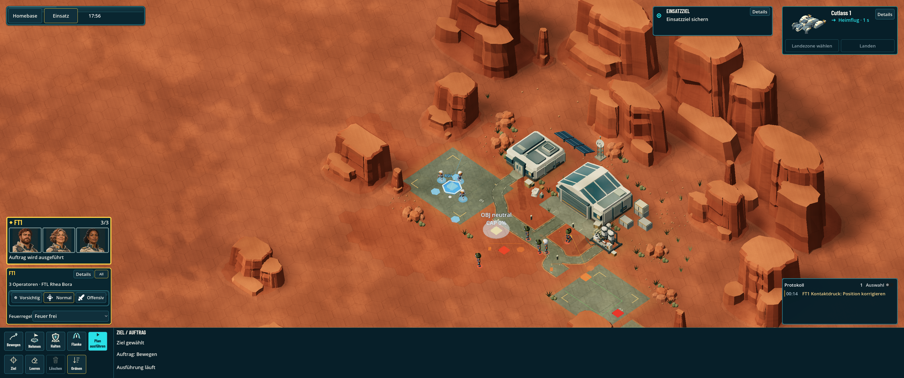

# CPU/HUD R8: fertige Wegpunkte einmal darstellen

08.11.2026; Basis Main5ac0642fddd36e79604efb883602dbdc655abaa1,
Branch codex/cpu-hud-r8-20261108. Bewusste Fortsetzung des integrierten R7.
Mainintegration/Main-Smoke/Push/Remote folgen separat mit Receipt.

## Problem / Ursache / Korrektur

Verbleibende lange Frames sind weiter offen. Dieser Pass endet nach dem
engen geprueften Fix; keine weitere Ursachenrunde oder Grafik-/KIausweitung.
Frische Prozessabfrage fand SteelDivision2 nicht mehr. Kein Fremdprozess
beendet. Frische Serie deshalb getrennt von den alten Fremdlastmessungen.

Ein Move-/GO-Paar baute dreimal vollstaendige Orderdarstellung: beim Anlegen
des noch generischen Wegpunkts, bei seiner Typfinalisierung und beim GO.
Die Callerspur zeigt also doppelte Movearbeit, kein doppeltes GO. Dasselbe
Muster bestand im echten verbundenen Client-Planungseinstieg. Gettermengen
fuer visuelle Stile waren haeufig, aber billig; kein entsprechender Patch.
Der erste Default-Szenario-Komponentenaudit akzeptierte keine Befehle;
nur die authored Frontierprobe mit akzeptierten Move/GO traegt diese Aussage.

Nur die zwei synchronen Finalisierer fordern beim Create keine volle
Zwischenprojektion mehr an. Beide projizieren den fertigen Typ weiterhin
synchron vor Rueckgabe. Contextmenue behält sofortige volle Vorschau als
Default. Leere oder spaet ungueltige Ziele behalten ihre Fehlerprojektion.

Kontaktmeldungen/First-Contact-Framing bleiben an der urspruenglichen
Zwischengrenze durch refresh_contact_overlay erhalten. Das ist notwendig:
volle Orderpublikation konsumiert Kommunikationsereignisse, die sonst erst
danach produziert wuerden. Kein Cache, Scheduler-/Kadenz-/Budget-/Sichtweiten-
oder Qualitaetsabbau, keine Actor-/HP-/Positions-/Timer-/Fuelpatches. Runtime-
Commands und Mutation bleiben in ihren bisherigen Ownern/Grenzen.

**Umfangsgrenze:** Realer Connected-Client-Planungsgewinn plus Korrektur des
direkten Testeinstiegs, den die native Messroute verwendet. Kein behaupteter
Geschwindigkeitsgewinn aller normalen Singleplayer-Buttons/Contextmenues.
Ein reduzierter Messpfadanteil ist nicht pauschal ein ganzes Spiel-FPSfix.

[Task](../../tasks/CPU_HUD_R8_2026_11_08.md),
[Contract](../../dev/mission_hud_projection_authority_contract.md),
[Review](../../reviews/CPU_HUD_R8_2026_11_08_review.md).
Produkt nur Controller; neu Verifier/Audit/Manifest/Pinrunner/Packager und Doku.

## RED / GREEN / Review / Gesamtpruefung

RED27/5 ohne Enginefehler: nur vier doppelte direkte Typfinalisierungen und
verbundene Clientplanung rot. GREEN32/0, Append-/Spaetfehlergrenzen36/0,
beide Darstellungswege40/0. Erstes unabhängiges Review fand fehlende
Kontaktreport-Vorproduktion. Neue synthetische Kontaktquellen fuer direkten
und echten verbundenen Planer reproduzierten RED44/2; genau zwei komplette
neue Eventdicts fehlten im finalen nativen Payload. Mit erhaltener partieller
Kontaktaktualisierung GREEN46/0. Keine Actor-/Commandinjektion in diesen
Kontakt-Quellfixtures; sie sind Komponenten-, keine physischen Spielbelege.
Erneutes Source-/Testreview ohne verbleibenden konkreten Blocker.

Finale Matrixv2 **93/93**, errors0, private Canarys/Source-/Rosterguards stabil.
Vollstaendige neue Eventdicts, Native-/Legacy-Planfelder, Append/Replace,
Menue-/Leer-/Spaetfehler, einmalige volle Planungspublikation und unveraenderte
Actors/Ticks/Queues geprueft. Nachbarn behalten echte Move/GO-Physics-Commits,
Authority-, Reentry-, HUDqueue-, Interaktions-, Sichtlinien- und Visualgates.
Die erste93er-Matrix wurde kontrolliert beendet, bevor der Quellstand korrigiert
wurde; nur eigener identifizierter Runner/private Kindengine gestoppt.
Ihre Teil-Logs bleiben erhalten und werden nicht als fertige Matrix ausgegeben.
R8-Runner pinnt geerbte Testhelfer und TerrainTileData zusaetzlich explizit.

|Drei akzeptierte Komponentenpaare|Vorher|R8|
|---|---|---|
|Volle Orderprojektionen je Move/GO|3|2|
|Move ms je Paar|31.877/28.955/28.506|21.153/24.710/24.663|
|GO ms je Paar|60.681/33.692/25.726|44.537/32.711/26.650|
|Inklusive 3Dpublikation ms|14.903/17.064/10.389|11.528/15.406/9.063|

Kleine serielle synthetische Probe mit gleicher Callerspurinstrumentierung,
keine physische Route oder Signifikanz-/FPSbehauptung. Verschachtelte Kosten
nicht addieren. GO ist unveraendert; dessen schwankende Werte kein Go-Fix.

## Normale native90-s-Vollbildserie

Godot4.6.2/3440x1440/Vulkan/Forward+/Kamera22/1x/VSync1/240Hz/Physik60,max8,
Ryzen7800X3D/RTX4070TiSUPER,11Units/7akzeptierte MoveGO-Paare, gleiche Route.
Eigene Audits im Fenster pausiert, keine konkurrierenden eigenen Engines.
Erster Baselineversuch67/1: ausschliesslich Cameraunchanged rot, transform
verschoben, Max118.676ms. Keine Ursache behauptet/kein Inputpfad gepatcht;
Originaldaten erhalten. Unveraenderte Wiederholung68/0 ist Vergleichsbasis.

|90s|Frames|P50/P95/P99 ms|Max ms|>50/>100/>250ms|Sim/Wand|
|---|---:|---|---:|---|---:|
|Baseline wiederholt|6548|10.763/32.413/42.061|96.395|24/0/0|0.999835|
|R8 A|5905|12.339/35.102/47.757|106.893|41/1/0|1.000015|
|R8 B|6278|11.054/34.318/47.379|99.451|44/0/0|0.999725|

Alle68/0, Exit0/errors0, Kamera/Fokus und Source-/Roster-/Isolationsguards
stabil. Primaere HUD-P9518.914 ->19.341/19.339ms, kein HUDzeitgewinn.
Oeffentliche Move/GO-Paare Median50.531 ->50.521/48.296ms,
Max59.148 ->61.713/58.098ms. Kein konsistenter gesamter Command-/FPSgewinn.
Max1 periodischer HUDjob/Frame, Navpending/Effectqueue max0, Commandqueue max7,
Physikcatchup max5. Gesamte P99 und einzelne Maxima schlechter; Gegenbelege
offen erhalten. Historische196.071ms nicht reproduziert, nicht als geloest
behauptet. Kein isolierter Vergleich mit alten R7-Fremdlastserien, keine feste
Obergrenze, Ruckelfreiheits- oder Releaseabnahme. Keine neue GPUprobe;
GPUtime im normalen Harness unavailable. Historische GPUdiagnose erhalten.

Vorher-/Nachher-B-Aufnahmen geoeffnet: Mission/HUD/menschliche Figuren erhalten.
Zeitpunktbilder ersetzen keine kontinuierliche Pixel-/Framerateabnahme.
Das beobachtete Weglaufen vom Objective waehrend dieser Messungen folgt den
Test-Move-/GO-Befehlen alle12s zwischen Einsetzbereich und validiertem kurzem
Weg; kein Beweis autonomer Fehlentscheidung der normalen NPC-KI. KI unveraendert.

## Belege / Erhalt / Mainabschluss

[Vorher](captures/before_go_movement.png), [Homebase](captures/02_homebase.png).

[Manifest](manifest.json), [Sourcebindung](source_binding.json),
[Originaldaten](raw_evidence.zip), [Schutz](preservation_report.json).
Originalschutz1415/502/echter Spielerroster, bisherige R6-/R7-Zusatzpins sowie
2731 neue Startpins bleiben einschliesslich SHA256/Groesse/mtime geprueft.
GPUstand separat bytegleich mit Basiscommit gebunden. Fremde WIP, Altbelege,
fehlgeschlagene/abgebrochene Versuche erhalten. Kein Reset/Clean/Stash/Restore.
Packagerpruefung ist Bytes-/Quellen-/Guard-/Schutznachweis, kein Performance-PASS.

Taskbranch geprueft. Kontrollierter Mainfastforward, frischer privater nativer
90-s-Main-Smoke, normaler Push und exakter Remotevergleich folgen mit
separater Receipt. Danach nur dokumentarischer Nachtrag, kein Produktdelta.
Kein neuer EXE-/WAN-/KIumfang und keine weitere Performanceuntersuchung.
