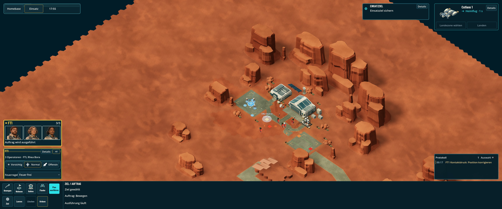

# HUD-Architektur und Ruckelspitzen, 06.11.2026

Zwei falsche Aufrufrichtungen sind korrigiert: Tuer-Kollision/LOS wurden durch
den 3D-/HUD-Sync angewandt, und HUD-Getter aktualisierten Missionsablauf und
Countdown. Jetzt produziert die vorhandene Runtime diese Daten. Lesen und
Zeichnen schreiben sie nicht mehr. Der Test ohne HUD und 3D-Ansicht besteht.

Im vergleichbaren ersten 38-Sekunden-Fenster sinkt das beobachtete Maximum
eines HUD-Aufrufs von **207,868 auf 79,006 ms**. Die groesste Framezeit sinkt
von **278,098 auf 140,208 ms**. Das ist ein beobachteter Fortschritt auf dem
gleichen aktuellen Monitor, keine allgemeine Ruckelfreiheitsabnahme.

Basis: Main `be1dd404a61317f18307e0eff42a0530f07fa647`, eigener Taskbranch
`task/hud-architecture-20261106`. Die abschliessende Main-/Remotepruefung steht
separat in `main_receipt.json` neben diesem unveraenderlich eingefrorenen Paket.
Ein ZIP-Neubau nach dieser Integration ist nicht vorgesehen.

## Was sich geaendert hat

- Der Driver leitet den effektiven Tuerindex aus seinen vorhandenen
  Interaction-Daten und realen Kartenmarkern ab. Configure, Fortschritt,
  Remote-Publikation und Tick aktualisieren die Registry. Die gemeinsame
  85-Prozent-Grenze fuer offene Tuer und freie LOS bleibt erhalten.
- Registry-Neuaufbau, Instanzwechsel und geaenderte Marker invalidieren die
  Projektion. Getter liefern defensive Receipts; sie reparieren nichts beim
  Lesen. Die Darstellung liest den tatsaechlich angewandten Tuerzustand auch
  bei lokalem Out-of-range-Feedback.
- Vier Driver-Getter sind lesend. Der vorhandene Runtime-Publisher aktualisiert
  Countdown und Gates auch waehrend der Kampf-Startpause. Client-Authority und
  die eigentliche Combat-Grace bleiben erhalten.
- Ein begrenzter HUD-Lesepass teilt Combat-/Decision-Projektionen. Ende,
  Framewechsel und Revision verwerfen die Werte. Rekursive Fallbacks werden
  nicht als stabile Ergebnisse gespeichert. Die Live-Commandmatrix verwendet
  vorhandene RAW-Texte vorwaerts, statt andere Panels wiederholt aufzubauen.
- Controls erhalten ihren finalen Stil. Die neun nativen A5-Actions bleiben
  bei ihrem Presenter. Periodisch versteckte alte Memberkarten werden nicht
  neu instanziiert. Sichtbarkeit und A5-Besitz invalidieren den Guard, damit
  Reveal ohne Force sofort aktuelle Karten zeigt.
- Auftraege werden konkret benannt: `Auftrag: Bewegen` plus
  `Ausfuehrung laeuft`. Zukunftsplan, gemischte Teams, fehlende Quellen,
  Pending und Ablehnung bleiben getrennt. Homebase zeigt einen eindeutigen
  Einsatzfeldtitel und eine semantische Bereitschaftsfarbe.

Der [Autoritaetsvertrag](references/mission_hud_projection_authority_contract.md)
und der [unabhaengige Review](references/HUD_ARCHITECTURE_2026_11_06_independent_review.md)
beschreiben Owner, Lebensdauer und Grenzen. **APPROVED scoped**, keine offenen
bestaetigten P1/P2 im geprueften Produktpatch. Das ist keine Gesamtabnahme.

## Gemessene normale Spielroute

Aktuell echtes **3440x1440-Vollbild**, Vulkan/Forward+, RTX4070TiSUPER,
Ryzen7800X3D, Monitor240,085Hz, VSync1, 60 Physikticks/s und normale 1x-Zeit.
Karte, gemessene Kamera mit Groesse34 und Qualitaetseinstellungen stimmen
ueberein. Elf echte Units (drei eigene, acht Gegner), normale Move-/GO-Aufrufe
alle zwoelf Wandsekunden; keine Actor-, HP-, Positions-, Ankunfts-, Entlade-,
Timer- oder Autoritaetspatches.

| Erstes 0 bis 38 s | Neue Baseline | Geprueftes Final |
| --- | ---: | ---: |
| Vollstaendige Frames im Fenster | 1112 | 1285 |
| Frame-p50 | 28,069 ms | 26,999 ms |
| Frame-p95 | 89,415 ms | 65,728 ms |
| Frame-p99 | 165,136 ms | 113,552 ms |
| Frame-Maximum | 278,098 ms | 140,208 ms |
| Frames ueber 50 / 100 / 250 ms | 208 / 44 / 2 | 164 / 21 / 0 |
| Eindeutige beobachtete HUD-Aufrufe | 112 | 113 |
| HUD-Aufrufmaximum | 207,868 ms | 79,006 ms |
| CombatDensity-Aufbauten je HUD-Pass, maximal | 51 | 2 |
| Decision-Aufbauten je HUD-Pass, maximal | 34 | 1 |

Frames werden nach Endzeitpunkt `0 <= elapsed_usec <= 38_000_000` gewaehlt,
ohne Randinterpolation. Quantile verwenden Nearest Rank. Persistente
HUD-Snapshots werden nach Invocation-ID dedupliziert, einschliesslich der
Command-Aufrufe. Die erste beobachtete Invocation hat eine unklare linke
Zeitgrenze; die Analyse weist Summen mit und ohne sie separat aus.
Verschachtelte Teilzeiten werden nicht doppelt addiert.

Die ersten drei synchronen Move+GO-Paarzeiten sind
77,786 / 71,744 / 76,500 ms vor und 71,058 / 65,928 / 71,073 ms nach der
Aenderung. Dies misst Aufrufarbeit, keine Ankunftslatenz.

Der **gesamte** gepruefte 90-s-Lauf besteht **63/63**, Exit0, Enginefehler0,
stabile Quellen und verifizierte Userdatenisolation. Er umfasst 3949 Frames
in 90,014950 s sowie 5400 Ticks: Simulations-/Wandzeit **0,999834**.
Whole-run-p50/p95/p99/max: 17,323 / 56,570 / 96,098 / 145,424 ms.
Es bleiben 36 Frames ueber100ms; es gibt keinen ueber250ms. Navigation:
maximal wartend/verzoegert0/0. Das ganze 90-s-Mittel wird nicht gegen das
38-s-Mittel als Verbesserung ausgegeben.

Ein vorheriger 90-s-Versuch blieb **60/1**: Die Kamera wechselte von34 auf14,2.
Er ist fuer Framevergleiche ausgeschlossen; die Ursache wurde nicht als
Produktbug oder Benutzereingabe behauptet. Der Wiederholungslauf ergaenzt
nur einen lesenden Kameraaktionsbeobachter und einen 4-Hz-Kameraleser. Diese
behandeln keine Inputs und setzen nichts zurueck. Audit: keine Kameraaktion,
nur die erste unveraenderte Kameraprobe. Die zusaetzlichen Lesezugriffe und
leicht unterschiedliche normale Startpositionen begrenzen einen kausalen
Vergleich. Ein Lauf je Bedingung ist keine statistische Verteilungsfreigabe.
Die Serie vom05.11. verwendete einen anderen Monitor und wird nicht verglichen.

[Analyse](analysis.json) und [reproduzierbares Analyseskript](analysis_work.py)
trennen das gemeinsame Fenster, Zwischenstaende und den ganzen Final-Lauf.

## Regression und zwei echte Multiplayerprozesse

| Gezielter neuer Komponentenbeleg | Assertions |
| --- | ---: |
| Finale Basisstyles | 605/0 |
| Homebase Flightdeck | 72/0 |
| Begrenzter ReadScope | 34/0 |
| Live-Projektion, vollstaendige Section-Paritaet | 163/0 |
| Door Runtime / Getter / Lifecycle / Grace | 85/0 |
| Konkrete aktive Order | 46/0 |
| HiddenCards und nicht erzwungener Reveal | 77/0 |
| Nativer A5-Stylebesitz als Komponentenfixture | 134/0 |

Die erhaltene Komponentenmatrix bleibt ehrlich **10/11**: Der alte Batchtest
forderte noch den Aufbau der absichtlich versteckten Memberreihe. Der
fokussierte Ersatz besteht **43/0** und prueft jetzt die aktuelle sichtbare
Portraitkarte gegen den Owner-Movement-State, erhaltene versteckte Instanzen,
echte Commands, Physics-Commit, GO, Interleaving und frisch geoeffnete Details.
TASK1044 und Homebase Operations bestehen15/0 und62/0. Kein roter Rohbeleg wurde
ueberschrieben oder nachtraeglich umetikettiert.

Die finale Nachbarmatrix besteht nach den letzten Produktkorrekturen **15/15**.
Darunter alle sieben zuvor roten Gates: TASK11132/0, TASK11330/0,
TASK230127/0, TASK401125/0, TASK43659/0, TASK46823/0 und Firesector49/0.
Diese sieben Produkt-/Orakelkorrekturen lagen bereits auf dem Basis-Main;
diese Runde bestaetigt sie erneut. Die acht Nachbarn pruefen Countdown,
Missionsgates, Doorcontract, Producer, Objektreaktion, Visualswap, Authority
und den Door/Computer/Cargo-Slice.

Zwei echte GUI-Godot-Prozesse bestehen erneut den normalen lokalen
Host-/Join-/Ready-/Missions-/Drop-/ersten-Befehlspfad. Beide laufen in
3440x1440-Vollbild mit getrennten frischen Profilen. Runnergate `pass`,
zehn Runnerchecks gruen, Enginefehler0 bei beiden, 1767 Quellpins unveraendert,
normaler eigener Exit und aktiver Roster unveraendert. Das ist Loopback auf
einem Rechner, kein LAN/WAN-, Mehrrechner-, EXE- oder Hostmigrationsbeleg.

## Vergleich mit den originalen 2D-Zielen

Der [Referenzreview](references/HUD_ARCHITECTURE_2026_11_06_reference_review.md)
ordnet die Originale und spaetere Nutzerkorrekturen zu. Palette, linke
Portraitteams, zwei Befehlsreihen und die Ref03-Schiffskarte sind erkennbar.
Die beiden kleinen Readoutkorrekturen sind an echten Final-PNGs bestaetigt.
**Komposition und Weltinszenierung bleiben deutlich von den 2D-Zielen entfernt**:
viel freie Sandflaeche, kleine entfernte Figuren sowie eine gleichfoermige
Vier-Spalten-Heimatbasis statt der staerkeren Szenen-/Schritthierarchie.
Keine erfundene Prozentnaehe und keine gestalterische Nutzerfreigabe.

Die Homebase-Vorher/Nachherbilder liegen direkt unter
`raw/images/before_homebase.png` und `raw/images/after_homebase.png`.
Der normale Mission-Vorhervergleich `raw/images/before_go.png` liegt zur
Platzersparnis ausschliesslich bytegleich im ZIP. Originale und fruehere
QA-Pakete bleiben unangetastet; es wurden keine Bilder beschnitten oder skaliert.

## Verbleibende Grenzen

Der dominante wiederholte HUD-Lesekreislauf ist abgebaut; HUD-Aufrufe bis rund
80ms und weitere Framehitches bleiben messbar. Dies ist ein enger normaler
Spielpfad mit elf Units und kein langer Soak oder allgemeines FPS-Versprechen.
GPU-Framezeit war nicht verfuegbar. Es gibt keine neue EXE oder Releaseabnahme.
Initiale Clientregistryaenderungen ohne weitere Remote-Publikation und eine
physische Tuer-/Schussabnahme der normalen Mission werden hier nicht behauptet.
Der historische feste Legacy-Empfehlungskontext bleibt dokumentierte Schuld.

Mainintegration, frischer Main-Vollbild-Smoke, Quellbindung und Erhalt der
geschuetzten Dateien werden separat in `main_receipt.json` quittiert.
