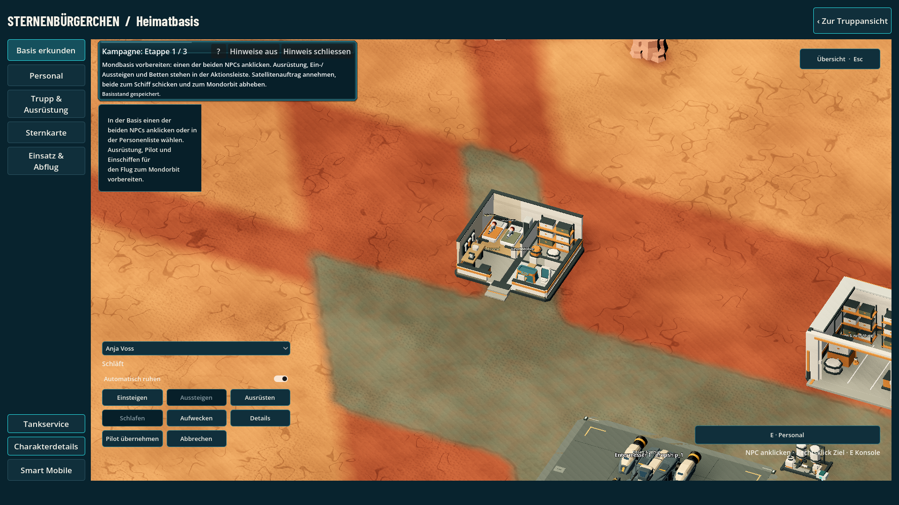
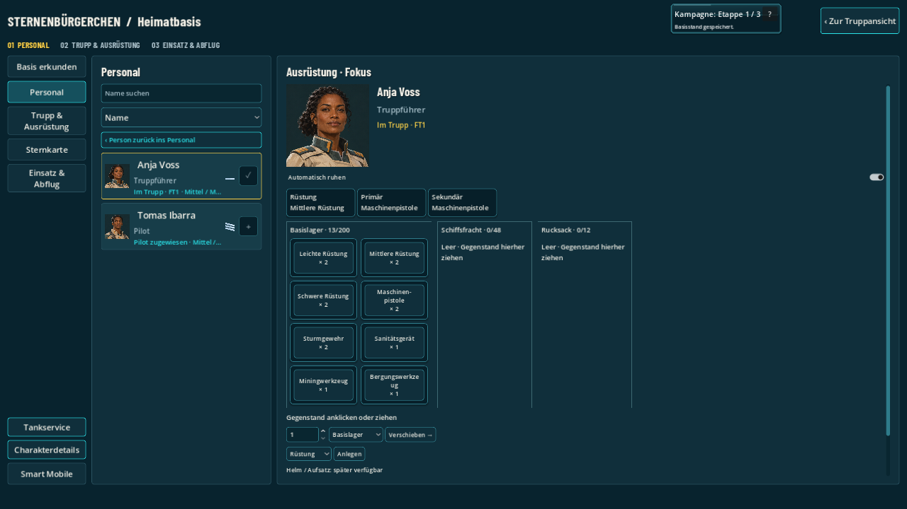
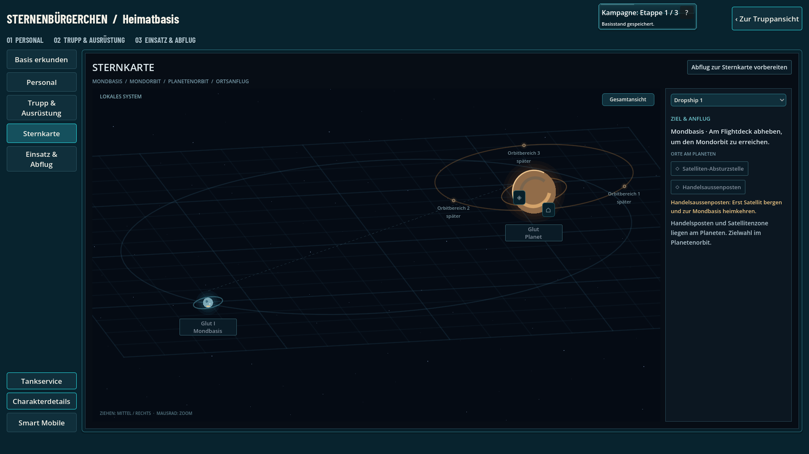
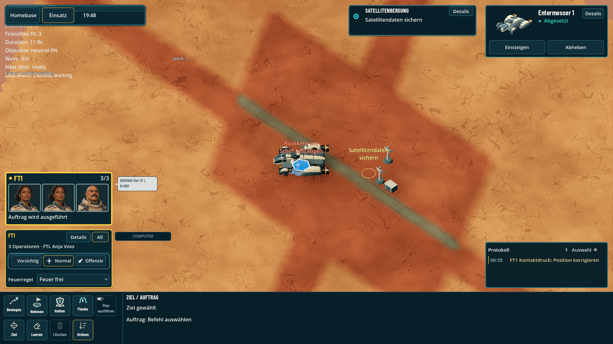
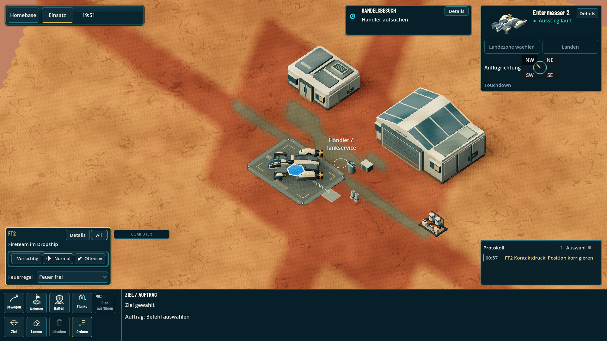
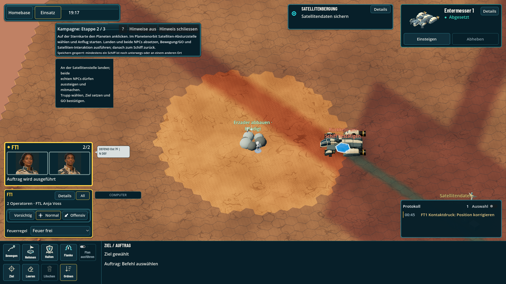
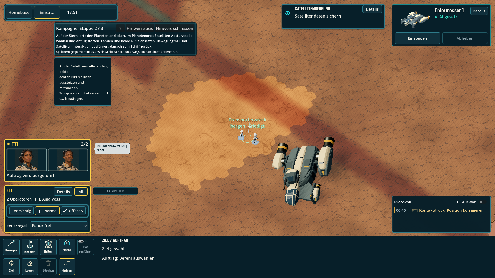
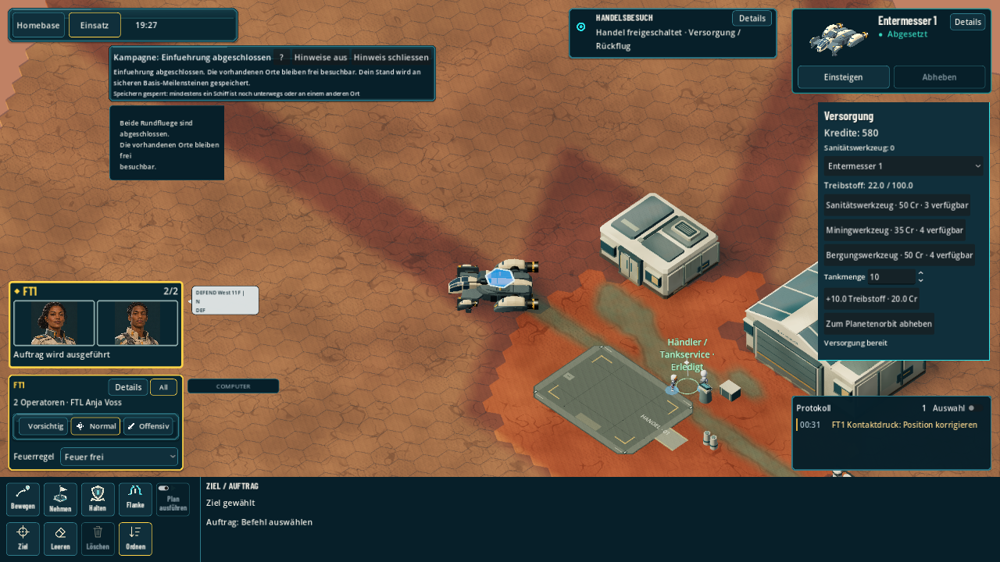

# Kampagnen-Playtest: technischer Abschluss

10.11.2026. Quelle auf task/playtest-rest-resources-20261110 im isolierten
Checkout C:/dev/SternenBuergerchen-worktrees/playtest-rest-resources-20261110.
Aufbau auf 046b6d91a und den lokalen AP0–AP8-Commits bis 274f142c2;
Basisruhe b8ae63250, Ressourcen/Grafik bc1e514d0, anschliessender Review-Fix.
Keine Main-Integration oder neue EXE/PCK. Vorhandene Nutzerspielstaende und
laufende Nutzer-EXE wurden nicht angefasst; jede Probe verwendete eigenes APPDATA.

## Ergebnis des Arbeitsplans

| Paket | Umgesetzt |
|---|---|
| AP0/1 | Ursprungsbuild eingeordnet, gelandetes Schiff auswaehlbar, sichtbares physisches Einsteigen und getrenntes Abheben, echte Auftragsrueckmeldung. |
| AP2/3 | Planmodus-Schalter und sofortiger Rechtsklicklauf, freie sichere Landeflaeche, vier vorhandene Richtungen als Uhr, Abbremsen/Flare/Schweben/Aufsetzen mit Abgasstrahl, sichere Skillabweichung und richtiger Rueckkehranker. |
| AP4/5 | Gemeinsame langlebige Ortsgrundlage; vier grosse Karten mit 9408 Hexen, kompakter erweiterbarer Basiskern, kein dekorativer Steinkantenzaun. Bodenmaske mischt Weg, Schulter, Sand und Geroell felduebergreifend; Grid ist eigene Kantenprojektion. |
| AP6/7 | Ein endlicher Inventarowner fuer Basis, Schiff und Rucksack, atomarer Ausruestungstausch und DnD/Knopfwege; schmaler Personalroster, gemeinsames Trupppanel, echtes Schiffsvorschaubild, FOB entfernt, Smart Mobile unten. Orte auf Glut anklickbar, Schiffsdarstellung aus aktueller Entermesser-Revision, Zoom/Pan erhalten. |
| AP8/9 | Unabhaengige Craftreisen, gemeinsam erhaltener Ort fuer zweite Besucher, versteckte Simulation tickt weiter. Satellit, Erz und Wrack als unabhaengige Zwecke. Entdeckung, echtes Werkzeug, zeitgesteuerter Use, begrenzter Ertrag, Kapazitaetspruefung und lokaler Frachtzugriff; Depletion mit Supply gespeichert. |
| NPC-Nachtrag | Leerlauf geht tatsaechlich zu freiem Bett. Automatisch ruhen pro Person an/aus in Basis und Inventarmenue; manuelle Bewegung, Ausruestung und Boarding haben Vorrang. Checkbox ueber Save/Continue. Keine erfundene Heilungs-/Beduerfniswirkung. |
| AP10 | Frischer nativer Ressourcen-/Kampagnenlauf, zwei Ausfluege/Heimkehrten und Continue; Mehrtrupp-Wiederbesuch; native 3-Aufloesungs-Pruefung; frischer Gesamtreview und regressionsgesicherte Korrektur. |

## Gezielte Nachweise

| Pruefung | Ergebnis |
|---|---|
| Echte NPC-Ruhe, beide UI-Schalter, Bewegung/Ausruesten, Continue und Einsteigen direkt aus Betten | 19/0 |
| Frischer nativer Ressourcen-/Kampagnen-Gesamtlauf, sichtbares Einsteigen, beide Heimkehrten | 175/0 |
| Zwei reale Ortsinstanzen, unabhaengige Reisen, Rueckkehr eines Besuchers | nativ 43/0 |
| Zwei Besucher desselben Orts, A heim, neue Ruestung, neuer Besuch mit erhaltenem B | 61/0 |
| Finale Review-Regressionen inklusive lokaler Actorbereinigung und Rueckzuordnung | 12/0 |
| Ressourcenstock/Tools/Kapazitaet/Retry/Restore/alte Angebote | 16/0 |
| Aktuelle Wrackgeometrie mit passender gespeicherter Navigation/Sicht und erreichbaren Arbeitspunkten | 3/0 |
| Personal/Trupp/Abflug/Sternkarte/Basis in 1280x720,1920x1080,3440x1440 | 15 native Ansichten, Abmessungen bestaetigt |
| Echter Handels-Folgeausflug, Service in drei Aufloesungen, sichtbarer Einstieg, Rueckkehr | 62/0 nach Layout-/Textkorrektur, einschliesslich echtem Continue |
| Gezielte kurze Quellsuite | 17/17 Skripte erfolgreich; keine Engine-/Scriptfehler in source-final-*.log |

Rohbelege liegen lokal unter output/playtest_20261110. Fruehere fehlerhafte Proben
wurden erhalten; die jeweilige finale Probe ersetzt die zugehoerige Abnahme.
Die Ursache und Korrekturen stehen in [REVIEW.md](REVIEW.md).
Ein aelteres TASK311-Rotationsgate war 7/1 sowohl auf unveraendertem 046b6d91a als
auf dem Taskstand. Kein neuer Fehler; daher keine Behauptung eines vollstaendig
gruenen Gesamtprojekt-Testbestands.

## Referenzvergleich und native Bilder

Originale 2D-Ziele mit Herkunft/Hashes:
[Referenzmanifest](../../reports/assets/playtest-2026-11-10/manifest.json).
Inventar-, Basis-, Handels- und Sternkartenreferenzen wurden einzeln betrachtet.
Hashes der aktuellen Material-/Propquellen und nativen Bilder stehen in
[presentation_manifest.json](presentation_manifest.json).

Die folgenden Bilder sind echte Godot/D3D12-Aufnahmen. Referenzbilder bleiben
Zielentwuerfe. Die persoenliche Stilabnahme steht aus; insbesondere sind die
Inventaritems derzeit benannte Karten, keine voll ausgearbeiteten Itemgemälde,
und das Wrack verwendet die aktuelle Entermesser-Geometrie gekippt/eingesunken.
Satellit/Handel wurden bei Kameragroesse22 und1920x1080 vor/nach Revision verglichen.
Die Mehrtrupp-Skirmishbilder enthalten den dortigen Diagnoseoverlay; die echte
Zwei-Personen-Kampagne ist in den Ressourcen-/Servicebildern dokumentiert.

## Verbleibende Grenzen

- Persoenliche Stil-/Lesbarkeitsfreigabe offen. Technische Funktionsabnahme ist
  keine Behauptung gleicher Detailtiefe wie ein KI-Referenzbild.
- Sekundaerwaffe ganz ablegen hat noch keinen eigenen Inventarknopf (Review-Minor).
- Mehrschiff-/Mehrort-Weltcheckpoint bleibt sichtbar gesperrt; sichere bestehende
  Kampagnencheckpoints und endliche Ressourcen werden erhalten. Kein Multiplayerexport.
- Profilwerte bleiben begrenzt: frueher30s je1/2/3 Orte P9527.3/10.5/12.9ms,
  Spitzen238/580/432ms, Speicher687/794/845MB. Neuer35s-Basisruhelauf P953.973ms,
  P9910.517ms, Maximum126.072ms, Start25.38s. Capture-only-Laeufe sind keine
  Performanceprobe. Keine allgemeine Fluessigkeits-/Releasefreigabe.
- Arbeitsumgebung: anderer Chat verwendet den Originalcheckout. Native Worktree-
  Registrierung blieb ownerless; darum separate lokale Git-Kopie. Fremde Dateien
  und ueberlappender WIP im Original wurden unveraendert gelassen. Bash-Taskextractor
  passt nicht zu AP0–AP10; gleichwertiges PowerShell/Python-Protokoll wurde gefuehrt.

## Schlussnotiz

Technische Task-Abnahme abgeschlossen: native Folgeprobe62/0, Review-Regression12/0,
Wiederbesuch61/0, Basisruhe19/0, Ressourcen-Gesamtlauf175/0 und gezielte Quellsuite17/17.
Alle genannten finalen Laeufe ohne Engine-/Scriptfehler; Stil-/Releasegrenzen bleiben
wie oben ausgewiesen. Der Taskbranch bleibt lokal erhalten.

[Ausfuehrungsprotokoll und Entscheidungen](EXECUTION_LOG.md).
