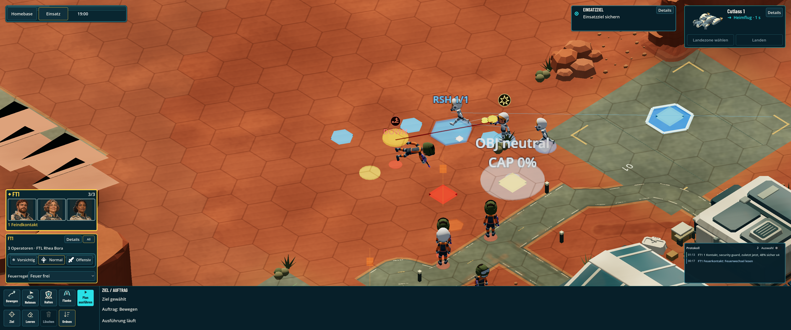

# R4: HUD-Arbeit, Bewegungsstart und lesbares Kampfgeschehen

Stand: 8. November 2026. Basis Main
`3b12b2878b42d1be0a7a2e8e925cf13835ff1d78`; Arbeitsbranch
`task/runtime-hitches-r4-20261107`. Gepruefter Codecommit `14a7e9188`.
Der Nutzer priorisiert am08.11. zunaechst Bericht und Code-Abschluss. Dieser
Checkpoint wird auf dem Arbeitsbranch veroeffentlicht. Die weitere native
Wiederholung, GPU-Diagnose, Mainintegration und Main-Smoke bleiben ausstehend.
Main ist unveraendert `3b12b2878`; dies ist keine Leistungs-/Mainfreigabe.

## Ergebnis und offene Leistungsabnahme

Die komplette aktuelle Regression besteht **75/75 Gates** mit privaten
Nutzerdaten, exit0, errors0 und stabilen Quellen. Die Korrekturen vermeiden
nachgewiesene redundante Arbeit und beheben konkrete Darstellungsfehler.
**Das Ziel allgemeiner Ruckelfreiheit ist weiterhin nicht erreicht.**
Der letzte native Nachlauf besteht die Funktionspruefungen, ist insgesamt
aber deutlich langsamer. Dieser Gegenbeleg bleibt erhalten.

| Native90-s-Serie | Datum | p50 / p95 / p99 ms | Max ms | >50 / >100 / >250 ms | Sim/Wand |
| --- | --- | --- | ---: | --- | ---: |
| Frischer Main-Vorlauf | 07.11. | 20.123 / 61.822 / 98.479 | 191.219 | 392 / 34 / 0 | 0.998952 |
| Main-Vorlauf wiederholt | 07.11. | 16.165 / 47.303 / 76.816 | 122.059 | 183 / 10 / 0 | 1.000035 |
| R4 mit HUD-Queue, vor Nearest-Korrektur A | 07.11. | 15.257 / 48.192 / 66.295 | 158.258 | 189 / 11 / 0 | 0.999783 |
| R4 mit HUD-Queue, vor Nearest-Korrektur B | 07.11. | 14.396 / 45.583 / 68.157 | 145.437 | 183 / 8 / 0 | 0.999906 |
| Frischer Vorlauf vor Nearest-Korrektur | 08.11. | 13.173 / 44.149 / 88.497 | 198.134 | 182 / 27 / 0 | 0.999315 |
| Nearest-Korrektur A | 08.11. | 21.011 / 74.980 / 143.812 | 321.078 | 463 / 85 / 6 | 0.980801 |

Alle Serien verwenden den gleichen regulaeren Menu-/Roster-/Dropship-/Unload-
Pfad, Kamera22, normales1x und echte Move/GO-Auftraege alle12 Wandsekunden.
Godot4.6.2, Vulkan/Forward+, Vollbild3440x1440, Display240Hz, VSync1,
Physik60/max8, Ryzen7800X3D und RTX4070TiSUPER. Kamera, Fokus und Einstellungen
bleiben waehrend der Messfenster gleich. Elf Runtime-Units bleiben erhalten;
keine Actor-/HP-/Positions-/Timer-/Fuelpatches oder Qualitaetsreduktionen.
GPU-Framezeiten sind nicht verfuegbar. Verschachtelte und teils zuletzt
publizierte Scopetimings sind nicht additiv.

Die beiden teuren GO-Movement-Scopes bei48/72s sinken im frischen Paar von
28.907/31.553ms auf14.350/21.425ms. Das ist ein begrenzter Teilkostengewinn;
die schlechtere gesamte Frameverteilung und der Durchsatz0.980801 bleiben
ein eigener negativer Befund. Die urspruenglichen177ms sind keine feste
Obergrenze. Ein besserer Einzelmaximalwert ist keine belastbare Maxgarantie.

Ein nach dem langsamen Lauf erhobener Systemkontext beobachtet WarFront Demo
und HWiNFO. Die WarFront-Prozesse starten nach dem Ergebnisfile dieses Laufs;
das belegt deshalb keine Ursache fuer dessen schlechte Framezeiten. Fremde
Prozesse und Systemeinstellungen bleiben unveraendert. Der Kontext liegt
original in `external_load_20261108.json` im Rohdatenarchiv.

Der vorbereitete separate GPU-Harness aktiviert nur Diagnoseflags der beiden
eigenen Viewports. Er erfasst begrenzte Zeitreihen und Pipelinezaehler nach
dem [Godot4.6-RenderingServer-Vertrag](https://docs.godotengine.org/en/4.6/classes/class_renderingserver.html#class-renderingserver-method-viewport-get-measured-render-time-gpu).
Er ist privat parsergeprueft, aber noch nicht nativ ausgefuehrt. Seine
instrumentierten Messungen waeren ein eigener Diagnoselauf, keine unveraenderte
FPSbaseline. Der normale75-Gate- und Capturepfad bleibt unveraendert.

## Architektur und bestaetigte Korrekturen

- Periodische schwere HUD-Arbeit laeuft ueber vier primitive Jobkeys beim
  bestehenden UpdateManager, maximal ein Job pro Renderframe. Jeder Job
  liest innerhalb seines eigenen synchronen ReadModel-Passes frisch.
  Primary+Secondary/Legacy-Matrix bleiben wegen ihrer echten Gateabhaengigkeit
  gemeinsam. Full-API bleibt synchron, Lightfeedback sofort. Force, Reentry,
  alte Managerentries, Deferredtokens, Sceneexit und Managerfallback sind
  abgesichert. Zwischen Frames verbleiben keine Runtime-/RAW-Snapshots.
- Native Karten/Craft-Controls und finale Themeowners vermeiden redundante
  Overrides und Hide/Show-Ketten. Strategic-RAW nutzt die bereits lokal
  abgeleitete Next-Quelle. Order-/Previewleser teilen einen synchronen
  Quellbundle. Keine persistente UI-Gameplaywahrheit kommt hinzu.
- Fog publiziert weiterhin aktuelle Snapshots. Reine Last-seen-Ticks loesen
  keinen Geometrierebuild aus; die echte Visibilityprojektion bleibt relevant.
  Der LOS-Fallback bezahlt nicht nochmals die bereits delegierte Terrainquery.
  Sichtweite, Budgets und autoritative Regeln sind unveraendert.
- Nearest-Walkable prueft den unveraenderten Distanz-/Tieguard vor der
  Live-Begehbarkeit. Geblockte Kandidaten setzen keinen Gewinner. In zwei
  Zaehlfixtures sinken Lookupreads258 auf2 bei identischer Auswahl. Ergebnis-
  und kompletter Resolve-Payload bleiben auch bei direkten Feld-/Override-
  Aenderungen aktuell. Die lineare Distanzsuche bleibt bestehen; kein Cache
  oder Spatialindex wurde eingefuehrt.

SimulationRoot, Runtimekomponenten und Registries behalten ihre bisherigen
Zustaendigkeitsgrenzen. Der Schedulinghelper besitzt nur primitive Metadaten.
GO-Diagnose ist optional, defensiv und auf acht Receipts begrenzt. Externe
HUD-Phasen liegen ausserhalb der Controller-_process-Walltime und werden
ueber eigene Zeitstempel ausgewertet. Lifetime-MaxAge kann nachgelagerte
Evidenz-I/O enthalten; Aussagen zum Messfenster verwenden gefilterte Samples.

## Schuesse, Figuren und Sicht

Die leichte Muzzle-/Schussicon-Schicht ist unabhaengig vom kleineren
Heavy-Tracebudget. Sie nimmt die aktuellen acht Quellen, verbraucht alte
Receipts ohne Replay und folgt der vorhandenen Source-Sichtfreigabe. Pose
und Feedback waehlen gemeinsam das neueste aktuelle Fire-Event; angehaengte
Historie oder identische letzte drei Heavyevents koennen keine alte Aimpose
mehr festhalten. Der Marker sitzt an der echten importierten Waffenfront.

Die beiden vorhandenen A/F-Loadouts korrigieren die verkehrt orientierte
Meshchild-Achse bei erhaltenen Attachmentdefaults. Der StandShoot-Hold nutzt
die vorhandenen importierten Shoot-Oberkoerperspuren, damit die fortlaufende
Animation den Hold nicht nach dem Dirty-Guard ueberschreibt. Erfolgreich
geladene menschliche Gegner werden nicht mehr von einem Capsule-Core verdeckt.

Die nativen Combat-only-Laeufe verwenden regulaeren Start und echte Commands
ausserhalb des tatsaechlichen Objective-Capturekreises. Der62/0-Lauf zeigt
denselben frischen Player-Schuss nach35.814 und153.317ms mit Flash/Icon.
Der63/0-Seitenlauf zeigt einen natuerlich niedergeschlagenen Gegner mit
derselben Original-Model-/Proxyidentitaet, horizontaler menschlicher
Silhouette, Helm, Torso, Beinen und Waffe. Bodenauflage und vollstaendige
Durchdringungsfreiheit sind aus diesen Bildern nicht gesichert.

Die Sollzeit120ms der Seitenserie wurde real erst nach217.691ms gelesen und
zeigt bereits einen neuen echten Schuss;922.743ms zeigt ein neues Icon ohne
dessen inzwischen abgelaufenen Flash. Diese Serie beweist keine gleiche-
Schuss-Lebenszeit0/120ms. Das lesende Visualreview nennt alle IDs und Istzeiten.
Die Visualquellen sind identisch mit der finalen Variante; die spaetere reine
Nearest-Guardkorrektur ist im aelteren Combat-only-Quellpin noch nicht enthalten.

Im Seitenlauf entsprechen22/22 Target-Zustaende dem echten Observer-LOS;
22/22 Proxies folgen Target-ODER-Tile-Sicht. Die14 beobachteten Sichtwechsel
belegen keinen Nah-Ausblendungsfehler. Die bestehende breitere Tilefreigabe
kann Proxies auch jenseits des aktuellen Target-LOS erhalten. Es gibt keine
pauschale Sichtweitenvergroesserung. Das Hin-und-her-/Angriffsverhalten der
Gegner bleibt ein separater KI-Folgepunkt.

Kamera, Homebase und2D-Referenzannaeherung bleiben der geschuetzte R3-Stand;
der zugehoerige Vergleich steht in
[R3 REPORT](../reference_polish_r3_20261106/REPORT.md). In R4 wurden vorhandene
Modelle und Importclips korrigiert; keine neuen KI-/Blenderassets erzeugt.

## Native Originalbilder dieses Checkpoints

[Frischer Flash, reale35.814ms](captures/final_actual_combat/20261107T111243Z-3a6f5ee9/combat_captures/r4_actual_fire_000ms.png),
[derselbe Schuss bei153.317ms](captures/final_actual_combat/20261107T111243Z-3a6f5ee9/combat_captures/r4_actual_fire_120ms.png),
[Folgezustand bei928.223ms](captures/final_actual_combat/20261107T111243Z-3a6f5ee9/combat_captures/r4_actual_fire_900ms.png).
Die Sollzeit-Dateinamen sind keine exakten Aufnahmezeitstempel.

[Normaler Spielabstand22 nach dem letzten Messfenster](captures/nearest_native_after_a/20261108T102412Z-11f8a409/after_a_captures/06_go_movement.png),
[Homebase im gleichen regulaeren Vollbildpfad](captures/nearest_native_after_a/20261108T102412Z-11f8a409/after_a_captures/02_homebase.png).
Alle Kopien bleiben byte-identisch zu den Originalen; die Bilder ersetzen
keine allgemeine Leistungs- oder gestalterische Nutzerabnahme.

## Testoracles, Schutz und Integration

Der alte TASK174-ROOT-/Magazin-/Proxyachsenvergleich war bereits auf dem
Original-Main81/2 rot. Die sachliche Korrektur prueft die wirkliche Meshfront,
Magazinrichtung und den kanonischen Body-Back bei denselben0.85/0.70-Schwellen
und realen Idle-Vorbedingungen. Dazu wurde die echte Assetorientierung
korrigiert;85/0 folgt getrennt auf den erhaltenen RED.

Der alte Command-Batch-Test verlangte den Komplettburst nach einem einzigen
Prozessschritt. Alle43 fachlichen Praedikate bleiben erhalten; fuenf neue
Schedulinggrenzen pruefen die vier Managerframes. Der historische39/4-Lauf
bleibt neben dem48/0-Nachlauf erhalten. Die aktuelle75/75-Matrix hat keine
roten Ausnahmen. Der neue Nearest-Verifier folgt auf105/2 Counter-RED mit
107/0 GREEN; sein Originaloracle kopiert auch die beiden Tiehelper exakt.

Unabhaengige Reviews liegen unter `docs/reviews/RUNTIME_HITCHES_R4*` und
finden im gebundenen Scope keine offenen P1/P2. Technische Tests, native
Pixelsicht, allgemeine Leistung und gestalterisches Nutzerurteil bleiben
unterschiedliche Nachweise.

Der Wiederaufnahme-Schutzcheck bestaetigt1.415 vorhandene Dateien,502
bestehende Rosterdateien und den echten Spielerroster unveraendert in SHA256,
Groesse und mtime. Saemtliche Engines benutzen frische private Profile.
Das Checkpointpaket enthaelt [Manifest](manifest.json),
[Sourcebindung](source_binding.json), [Schutzpruefung](preservation_report.json)
und [Original-Rohdatenarchiv](raw_evidence.zip). Sein `passed` gilt nur fuer
Bytegleichheit, Quellenbindung und Schutz, nicht fuer Leistung oder Main.
Der Packager kennzeichnet `native_phase=deferred_by_user`. Alte REDs,
Zwischenlaeufe, Originalquellen und die negative Messung bleiben archiviert.
Die spaetere Fortsetzung muss neue Nachweise ergaenzen und dieses Paket
erhalten. Eine Mainquittung existiert fuer R4 noch nicht.
Fremde WIP-/Save-/Evidence-Dateien werden weder
committed noch aufgeraeumt oder restauriert. Keine neue EXE-/WAN-/Release-
Abnahme wird aus diesem Source-/QA-Paket abgeleitet.
