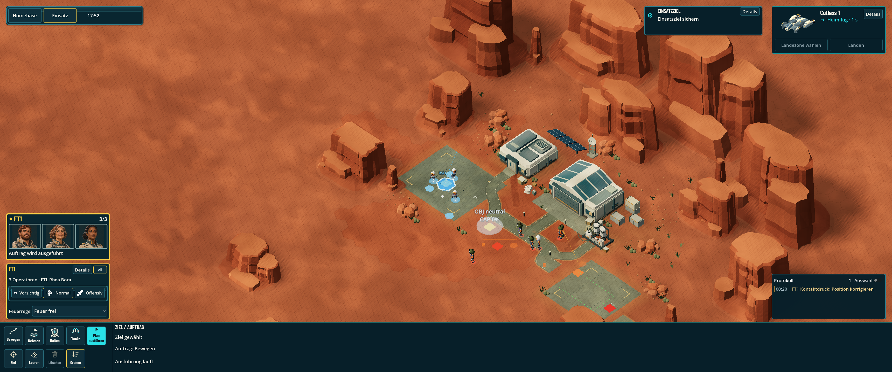

# R4-Fortsetzung: GPUgrenzen, Vollbildwiederholung und Main

Stand08.11.2026. Fortsetzung von `task/runtime-hitches-r4-20261107` auf
Checkpoint `3345fc573f566cd0927397092eebab8fbde7d524`, bewusst noch nicht
integrierter Task; Mainbasis `3b12b2878b42d1be0a7a2e8e925cf13835ff1d78`.
Produktcode `14a7e9188` bleibt unveraendert. Das alte QA-Paket wird erhalten.
Die aktuelle Main-/Pushquittung steht nach Integration in `main_receipt.json`.

## Problem, Ursache und Aenderung

R4 beseitigt belegte redundante HUD-/LOS-/Lookup-/Presenterarbeit und konkrete
Kampfvisualfehler; Details und RED/GREEN im erhaltenen
[Checkpoint](../runtime_hitches_r4_20261107/REPORT.md). Allgemeine
Ruckelfreiheit war dort weiterhin offen. Diese Fortsetzung prueft den
uncommitteten GPU-Diagnosestand, Rendergrenzen und Displayfacts sowie zwei
normale90-s-Wiederholungen. Kein weiterer Produktpatch ist aus diesen Daten
begruendet. Gameplay, Route, Qualitaet und normalen Messharness erhalten.

Aktueller GPUchild SHA256
`68b4f3521a3e8a51b46c27e0d088c822edade1f883f7dc00b89069513c1a9424`:
Pre/Post-Grenzen,64 begrenzte Displayfactsrecords, maximal16384 GPUrows,
exakte Messfenster und Timer-/Signalcleanup. Privater Parser Exit0/errors0.
[Unabhaengiger Review](../../reviews/RUNTIME_HITCHES_R4_2026_11_08_finish_review.md)
findet keine offenen P1/P2 im neuen Delta. Frische Gesamtmatrix75/75,
errors0, Source-/Privatprofil-/Rosterguards gruen.

## GPUdiagnose und Gegenbelege

Gueltiger Lauf `finish_gpu_boundaries_03/20261108T132624Z-ad86a7c7`:
70/0, Exit0/errors0,850 passende In-window-Pre/Post-Grenzen, kein Ringverlust,
keine verworfenen Displayfactsrecords. Positive Root-/Kartenmesswerte,
beide Timer aufgeraeumt, keine invaliden Viewportbeobachtungen.

Die zehn Displayfactsaufrufe brauchen167–254us. Damit ist der alte359.972-ms-
Peak nicht durch diese Abfrage erklaert. Ein historischer Zusammenhang bleibt
unbestaetigt; JSON-/Printkosten sind weiterhin nicht separat gemessen.
Kein Cache oder anderer Basisharnesspatch wurde auf Verdacht eingefuehrt.

| Diagnose | Median | P99 | Maximum |
| --- | ---: | ---: | ---: |
| Karten-GPU ms | 69.543 | 71.553 | 76.970 |
| Root-GPU ms | 0.094 | 34.239 | 35.477 |
| Pre->Post-Wandintervall ms | 39.473 | 79.745 | 106.912 |
| Postprobe us | 55 | 83 | 127 |

Root-/Kartenzeiten und Physics-/Scriptscopes koennen ueberlappen und werden
nicht addiert. Letzte GPUwerte sind keine garantierte Processframezuordnung;
Pre->Post ist ein Wandintervall mit moeglicher Wartezeit. Diagnoseinstrumentierung
ist keine unveraenderte FPSbaseline. GPUlauf P99=149.578ms, Max179.327ms.

Nach Godotende beobachtet `nvidia-smi`100% GPUlast bei laufender
`SteelDivision2.exe`. Das ist ein belegter Konkurrenzkontext, keine isolierte
Zuordnung aller GPUzeit oder aller Hitches zu diesem Prozess. Der Nutzer
waehlt ausdruecklich **Messung unter aktueller Last fortsetzen**. Fremde
Prozesse bleiben unberuehrt. Keine isolierte Produktleistungsabnahme.

Fehlversuch `finish_gpu_boundaries_02/20261108T132326Z-a32eff44`:
Root hatte das `{RUN}`-Argument nicht fuer PowerShell gequotet. Exit2 wegen
abschliessend nicht oeffenbarer Evidenzausgabe; kein gueltiger Gesamttest.
Log, Runnerreport und vier urspruengliche private JSONs bleiben separat im
Archiv. Der gueltige Wiederholungslauf benutzt nachweislich korrektes argv.

## Zwei normale Vollbildlaeufe ohne GPUprobe

Godot4.6.2,3440x1440, Vulkan/Forward+, Kamera22,1x, VSync1,
240Hz, Physik60/max8, Ryzen7800X3D, RTX4070TiSUPER. Beide Fenster haben
durchgehend Fokus. Je elf Runtime-Units, sieben akzeptierte Move/GO-Paare,
gleiche normale Route; keine Actor-/HP-/Position-/Timer-/Fuelpatches.
Die Fremdlast ist autorisiert, aber nicht kontrolliert konstant.

| 90-s-Serie | Frames | p50/p95/p99 ms | Max ms | >50/>100/>250ms | Sim/Wand |
| --- | ---: | --- | ---: | --- | ---: |
| A `finish_normal_a/20261108T133754Z-31f06e92` | 840 | 105.721/134.640/151.579 | 194.886 | 837/698/0 | 0.997734 |
| B `finish_normal_b/20261108T134038Z-98193de7` | 868 | 105.128/138.953/158.233 | 199.881 | 832/659/0 | 0.996363 |

Je68/0, Exit0/errors0, stabile Quellen und unveraenderter geschuetzter Roster.
Navpendingmax0, Effectqueuemax0, Commandqueuemax7, bis8 Physikticks pro Frame.
Diese Maxima sind keine Behauptung dauerhaft leerer Queues.
Maximal ein periodischer HUDjob pro Engineframe und vier pending Keys.
Phasenanzahlen A75/75/76/76, B77/77/77/76; maximale Startalter fuer Cards
523/557ms. Primaerphase maximal41.089/39.635ms; diese verschachtelten,
schedulingabhaengigen Scopes liefern keine komplette additive Frameursache.

Die gesamte Verteilung ist unter dieser Last langsam. Keine allgemeine
Verbesserung, feste177-ms-Grenze oder Ruckelfreiheit wird behauptet. Die
vorherigen isolierter erhobenen Serien und der negative321-ms-Lauf bleiben
historische Gegenbelege; neue Fremdlastwerte ersetzen sie nicht.

## Native Sicht und Dateien

Root hat die originale GPU- und B-Missionsaufnahme geoeffnet: regulare Mission,
menschliche Einheiten, Karte/HUD und aktueller Bewegungsauftrag sichtbar.
Die Aufnahmen liegen nach dem Messfenster; sie beweisen keine kontinuierliche
Framerate. Exakte Bodenauflage und KI-Angriffsverhalten bleiben die alten
separaten Grenzen. Keine neue gestalterische Nutzerabnahme.

Geaendert: nur GPU-Diagnosechild und neue Task-/Review-/QA-Dokumentation
sowie aktueller Status/Roadmap. Produktdateien bleiben auf dem geprueften
R4-Codepin. [Sourcebindung](source_binding.json), [Rohdatenarchiv](raw_evidence.zip),
[Auswertung](continuation_analysis.json) und [Schutz](continuation_preservation.json).
Der Paket-PASS gilt fuer Bytes/Quellen/Erhalt, nicht fuer Leistung oder Main.
Die alte447-Dateien-Evidence und elf versiegelten QA-Dateien bleiben unveraendert;
auch1999 beim Wiedereinstieg vorhandene untracked Dateien sind separat geprueft.
Kein Reset, Clean, Stash oder automatisches Restore. Kein EXE-/WAN-/Releaseumfang.

## Lokale Pruefung und Integration

Runner `run_runtime_hitches_r4_20261107.py`: neue private Overlays, Canarys,
echter Roster vor/nach jedem Lauf, Exit/Marker/Fehler- und Sourceguards.
Gesamtmatrix `finish_regression_final/20261108T132946Z-6552dd9f`:75/75.
Neue Quelle privat parsergeprueft; GPU70/0 und normale Wiederholungen je68/0.
Nur Root startet Engines seriell. Messfenster ohne parallele eigene Audits.
Main-Smoke und Remote-HEAD werden gesondert in `main_receipt.json` belegt.
