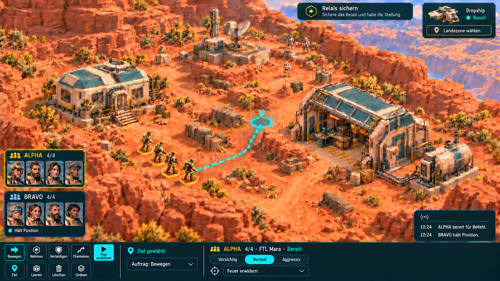
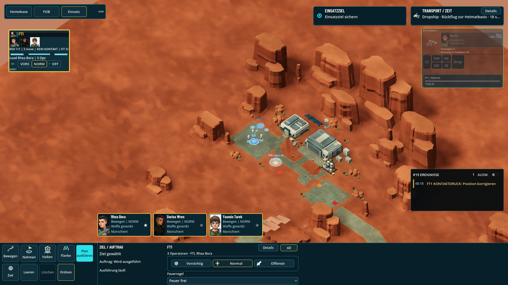
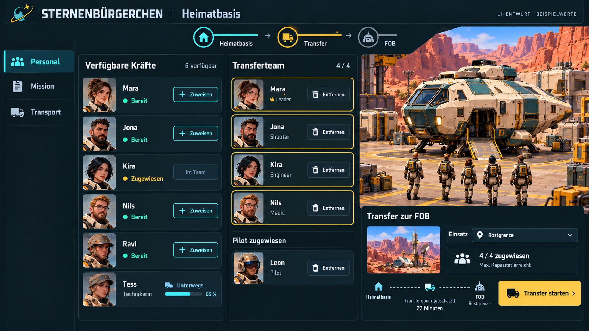
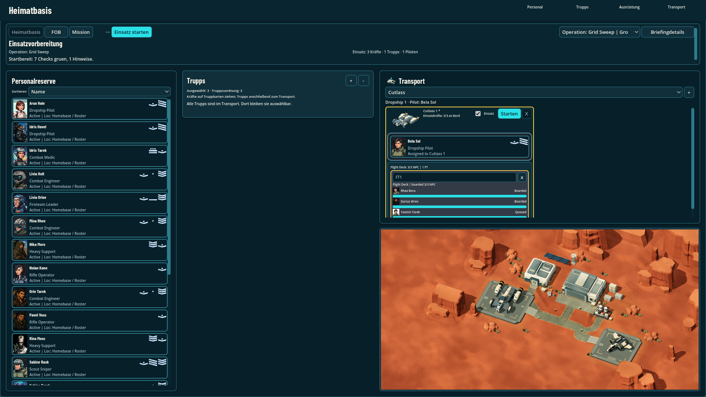
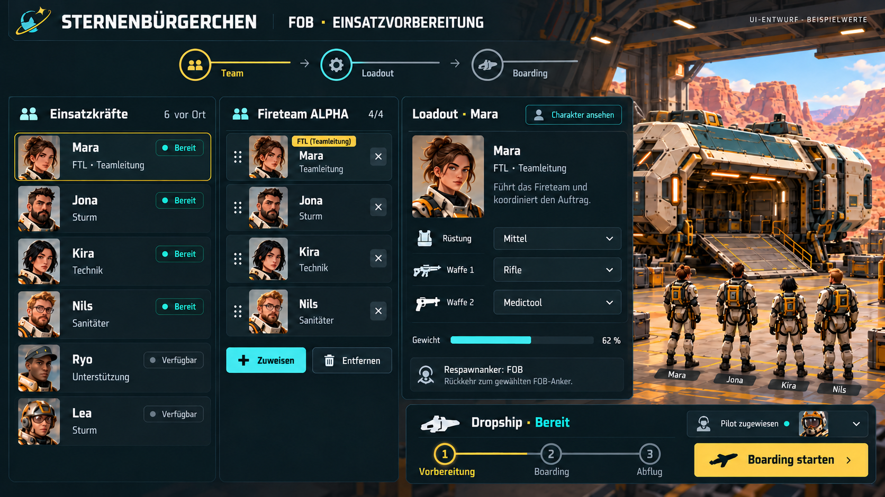
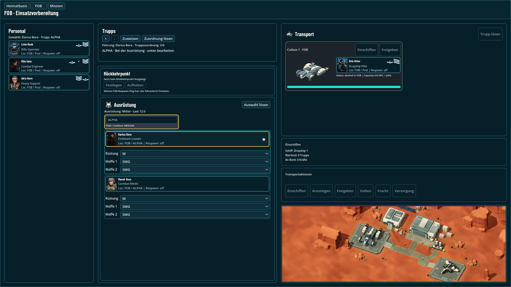
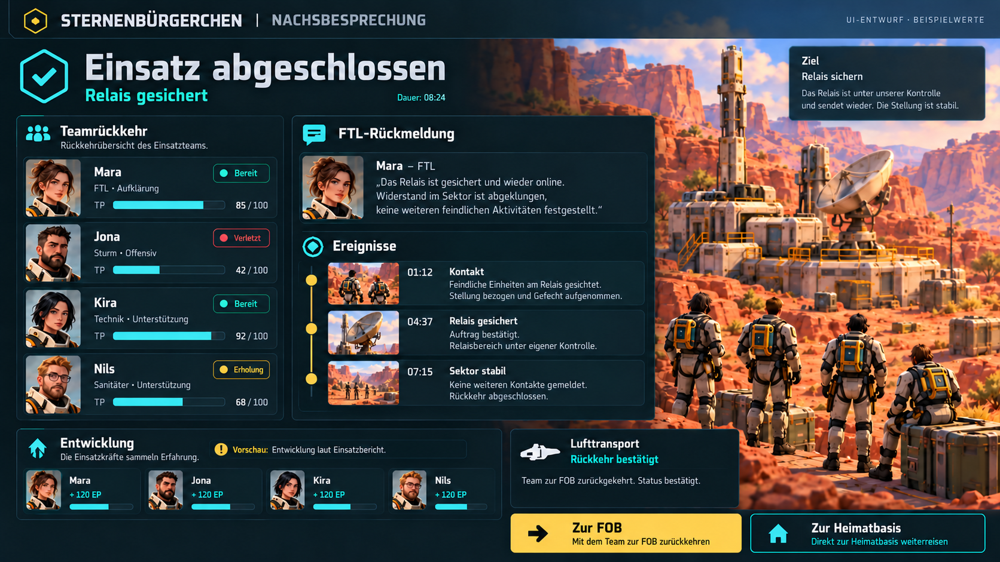
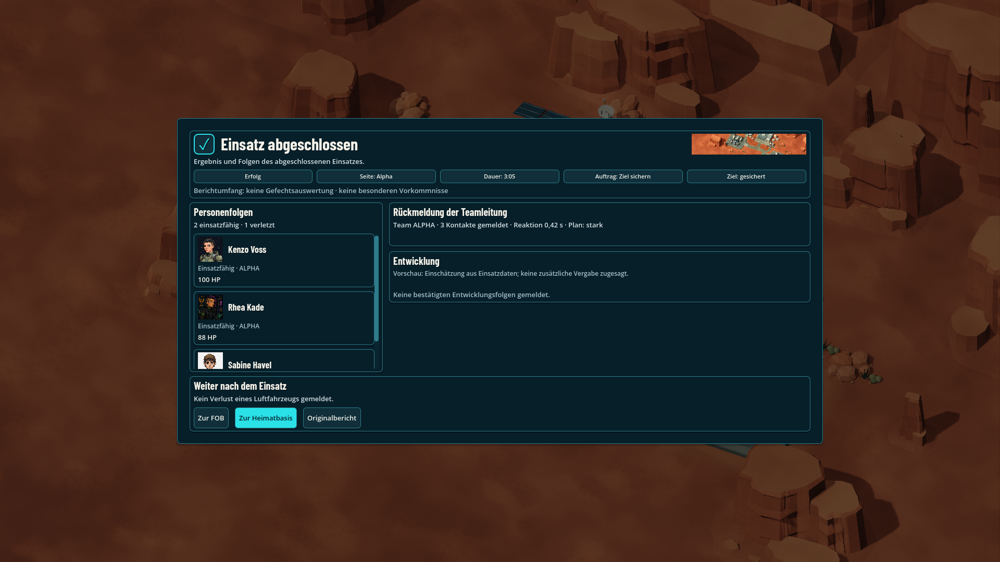

# Direkter Bildvergleich: bestätigte 2D-Ziele und nativer Ausgangsstand

## Reihenfolge und Aussagegrenze

Der Dokumentaudit und die minimale Vertragskorrektur wurden zuerst abgeschlossen (`docs/tasks/UI_2026_11_02_zielbild_abgleich.md`). Anschließend wurden die vier bestätigten Originalbilder und die fünf unten genannten nativen Bilder mit `view_image` tatsächlich geöffnet. Dieser Vergleich beschreibt den Ausgangsstand vor der neuen visuellen Runde am02.11.2026. Kein Brückenbild wird als neues Stilziel verwendet; historische Screenshots werden nicht verändert.

Die Originale sind1672×941, die ausgewählten nativen Bilder1920×1080. Größen werden daher als visuelles Verhältnis beurteilt, nicht als identische Pixelvorgabe. Namen, Personenanzahl, Missionswerte, Enable-Zustände, HP, Zeit und Entwicklung in den Konzepten sind Beispiele. Der aktuelle normale GM01-Lauf und die älteren R4-FOB-/Debrief-Fixtures belegen unterschiedliche Daten-/Bedienzustände; dieser Vergleich behauptet keine identische Missionssituation oder Funktionsabnahme.

## Geöffnete Quellen

| Screen | Bestätigtes Original | Nativer Ausgangsstand |
|---|---|---|
| Mission | [A5, zwei Reihen](../../reports/assets/ui-2026-11-01/mockup_a5_mission_zweireihig.png) | [GM01 kanonisch,1920×1080](../gm01_frontier_20261102/captures/mission_frontier_1920x1080.png), zusätzlich [normaler Lauf,07 Außenposten](../gm01_frontier_20261102/frontier/1920x1080_20261102T140614Z/startup_captures/07_outpost_overview.png) |
| Heimatbasis | [Original Heimatbasis](../../reports/assets/ui-2026-11-01/menu_heimatbasis.png) | [normaler Lauf,02 Heimatbasis](../gm01_frontier_20261102/frontier/1920x1080_20261102T140614Z/startup_captures/02_homebase.png) |
| FOB / Ausrüstung | [Original FOB](../../reports/assets/ui-2026-11-01/menu_fob_loadout.png) | [R4, belegte FOB](../ui_native_r4_20261102/captures/fob_populated_1920x1080.png) |
| Nachbesprechung | [Original Debrief](../../reports/assets/ui-2026-11-01/menu_debrief.png) | [R4, Debrief mit Portraitdaten](../ui_native_r4_20261102/captures/debrief_portraits_1920x1080.png) |

## Mission: UI und Karte getrennt beurteilen

**Rahmen und Informationshierarchie:** Im Original besitzen Teamkarten, Ziel, Dropship und Protokoll klare Petrolflächen, markante Ecken und wenige deutliche grafische Anker. Der native Stand verwendet überwiegend dieselbe dünne, weich gerundete Kontur. Das Protokoll unten rechts ist fast schwarz und gehört optisch weniger zur übrigen Petrolfamilie. Die zusätzliche Transportkarte rechts mischt durchscheinenden graubraunen Hintergrund, sehr kleine Texte und viele einzelne Controls; sie lässt sich schlechter als klarer Zustandsblock lesen als das obere kompakte Ziel-/Dropshippaar der Vorlage. Vorhandene Details dürfen deshalb nicht entfallen, brauchen aber einen verständlichen Primärzustand und einen erreichbaren Detailpfad.

**Typografie und Portraits:** Das Original hat eine gut gewichtete Teamkennung, große Gesichtsausschnitte und wenige kurze Statusangaben. Nativ enthält die kleine linke Truppkarte mehrere winzige Informationszeilen, Kürzel und Bedienelemente. Die zusätzlich über dem Band stehenden drei Personenkarten zeigen dagegen bereits deutlichere Gesichter. Diese verteilte Hierarchie unterscheidet sich von der portraitgeführten Teamübersicht der Vorlage. Ein größerer Titel allein behebt die kleinteilige Statusfläche nicht. Die echten Pixelportraits wirken außerdem wesentlich feiner gerastert und untereinander heterogener als die gemeinsame illustrierte Portraitfamilie des Originals. Bestehende Personenidentitäten bleiben dabei verbindlich.

**Befehlsband und Komposition:** Randanker und zwei echte Reihen sind bereits vorhanden. Die native Gruppe Ziel/Auftrag ist textlastiger; Haltung und Feuerregel nehmen eine breite mehrzeilige Fläche ein. Rechts davon bleibt sehr viel ungenutzte Bandfläche. Das Original bündelt die Teamparameter enger und trennt die drei Gruppen mit klaren vertikalen Grenzen. Kompaktere Tasten und ein engerer Teamparameterblock können den Nutzerwunsch nach Erweiterungsraum unterstützen. Die bloße Tatsache64px gegenüber50–52px ist bei unterschiedlichen Bildbreiten kein ausreichender Bildfehlernachweis. Entscheidend sind die sichtbare Dichte und lesbare Innenbeschriftung im tatsächlichen Viewport.

**Gelände, Modelle und Licht:** Der größte globale Abstand liegt außerhalb der UI. Die Vorlage zeigt eine dicht komponierte Rostlandschaft mit geschichteten Felswänden, mehreren Tiefenebenen, verschieden großen Stein-/Vegetationsgruppen sowie Gebäuden mit gestaffelten Dachflächen, tiefen Portalen, Sockeln, Stufen und warmen Eingangsakzenten. Im nativen Ausgangsstand sind große freie Bodenbereiche, voneinander getrennte hohe Felssäulen und zwei vergleichsweise einfache, quaderförmige Gebäudemassen dominant. Der engere normale07-Ausschnitt macht die Gebäude größer, zeigt aber weiterhin diese Formunterschiede. Weitere Konturen oder global mehr Sättigung können diese Geometrie-/Kompositionslücke nicht ersetzen. Eine größere Modell-/Geländerevision bleibt offen; sie muss eigene2D-Zuordnung, native Vergleichspaare und die tatsächlichen begehbaren Flächen erhalten.

**Hex und Sichtmaske:** Auf dem nativen freien Boden ist stellenweise eine sehr feine Wabenzeichnung erahnbar. Einzelne begehbare Hexfelder sind in dieser Gesamtansicht jedoch nicht so eindeutig ablesbar, wie es der Nutzer ausdrücklich wünscht. Die bestätigte A5-Illustration ist dafür kein Gegenauftrag, das Raster unsichtbar zu lassen. Klarere Strichstärke/Kontrast müssen bei normalem Spielabstand und1280×720 sowie1920×1080 beurteilt werden. Aus einem Standbild lässt sich kein zeitweises schwarzes Aufblitzen nachweisen. Vorhandene Terrain-Bodenabdunklung und der unabhängige Gegner-Sichtfilter bleiben getrennt; dieser Bildvergleich fordert keine Aufdeckung unbekannter Gegner.

## Heimatbasis: Arbeitsbereiche brauchen eigene Gewichtung

**Rahmen / Typografie / Portraits:** Das Original bildet kräftige Abschnittsüberschriften, gut lesbare Personenidentitäten, große Portraits und klar erkennbare Zustands-/Zuweisungsflächen. Nativ sind die Namenszeilen sehr klein; viel Kartenfläche entfällt auf Ranggrafiken und technische Orts-/Aktivitätszeilen. Große unbesetzte Panels werden mit derselben Konturstärke behandelt wie aktive Karten. Die vorhandene Barlow-Titelschrift ist ein Schritt zur Vorlage, prägt aber noch nicht die gesamte Informationshierarchie. Ein konsistenter Kopfbereich und deutlichere Abschnittsanker helfen mehr als zusätzliche gleichartige Außenrechtecke.

**Komposition:** Das Original organisiert links Personalnavigation, dann zwei vergleichbar gewichtete Personal-/Transferbereiche und rechts eine große Szene mit zusammengehörigem Transferabschluss. Nativ nimmt eine lange, eng gepackte Personalliste den linken Bereich ein. Die mittlere Truppfläche ist im gezeigten Zustand nach dem tatsächlichen Transportwechsel nahezu leer; die Zuordnung liegt richtig im Transportbereich rechts. Trotzdem bleibt darunter ein großer leerer Mittelraum stehen. Die rechte obere Transportfläche ist nur teilweise mit Karten belegt; die Szene erscheint als getrennte rechte untere Übersicht. Ein kompakter Leerzustand und belegungsabhängige Flächenaufteilung sollten die tatsächliche Verteilung erklären. Es wäre falsch, zur optischen Füllung eine zweite bearbeitbare Teaminstanz anzulegen oder die Beispielzahl4/4 zu übernehmen.

**Modell-/Szenenstil:** Die Vorlage inszeniert Besatzung und Schiff aus näherer Perspektive vor einer vielschichtigen Basis. Der native Bühnenrender zeigt einen kleinen Außenposten von weit oben mit deutlich mehr ruhiger Bodenfläche. Selbst mit identischen UI-Farben entsteht deshalb eine andere Gewichtung. Für eine spätere Bühnenrevision zuerst Kamera, Ausschnitt, menschlichen Maßstab und Kontaktzonen prüfen. Das erste Dropship bleibt die exakte vorhandene Cutlass; das andere Konzeptschiff ist keine Ersatzmodellfreigabe.

## FOB / Loadout: Auswahl und Bearbeitung sichtbarer verbinden

**Rahmen / Typografie / Portraits:** Die Vorlage zeigt drei gut unterscheidbare Arbeitsschritte und verbindet eine hervorgehobene Person mit einer eigenen Loadoutfläche. Nativ verteilen sich Truppzuordnung, Rückkehrpunkt und mehrere nacheinander eingeblendete Ausrüstungsformulare über die mittlere Spalte. Die gelbe Auswahlkontur ist vorhanden. Die vielen kleinen Portrait-/Textzeilen und gleichartigen dünnen Rechtecke erzeugen aber weniger klare Identitäts- und Bearbeitungsschwerpunkte. Kräftigere Abschnittsköpfe, verständliche Aktionsgruppen und eine deutlichere ausgewählte Person sind als begrenzter UI-Pass sinnvoll. Die tatsächlichen bestehenden Auswahl- und Mehrpersonen-Workflows dürfen nicht blind durch den im Konzept abgebildeten Einpersonenworkflow ersetzt werden.

**Komposition und Leerräume:** Im Screenshot bleiben unter den drei linken Personalkarten große leere Flächen. Rechts stehen eine große Transportfläche, eine separate Boarding-Zusammenfassung, ein weiterer Aktionsblock und erst ganz unten die relativ flache Bühnenansicht. Das Original setzt die Szene deutlich höher und größer und fasst den Boardingabschluss im unteren rechten Bereich zusammen. Die konkrete Datenbelegung ist verschieden; dennoch sind die Streckung leerer Karten und die starke vertikale Trennung der Transportinformationen sichtbar. Diese Abstände sollten nach tatsächlichem Inhalt verdichtet werden, bevor die Szene einfach vergrößert wird. Disabled-Transportknöpfe müssen weiterhin ihre echten Gates anzeigen.

**Modell-/Szenenstil:** Das Original zeigt einen nahen offenen Flugdeck-/Schiffskontext, vier Menschen und warme Innenbeleuchtung. Der native Bühnenausschnitt ist dieselbe entfernte Außenpostenübersicht wie in der Heimatbasis. Das ist ein erheblicher Szenenabstand, der durch Panelrahmen nicht verschwindet. Eine eigene aktuelle FOB-Komposition mit vorhandener Cutlass wäre eine separate Grafikarbeit; Figuren, Boarding und Schiffszustand dürfen dabei nicht als echte Runtimeereignisse vorgetäuscht werden.

## Nachbesprechung: Ergebnis und Personenfolgen stärker gewichten

**Rahmen / Typografie / Portraits:** Die Vorlage hat eine sehr deutliche Ergebniszeile mit großem Symbol, anschließend gut erkennbare Personenfolgen und eine visuelle Ereignisfolge. Der native Dialog besitzt das Ergebnis und die richtigen inhaltlichen Gruppen bereits, gewichtet sie aber wesentlich ähnlicher: kleineres Ergebnissymbol, schmale Titel, kleine Datenchips und gleichartige Konturen. Die Portraits sind vorhanden, bleiben jedoch klein innerhalb hoher Personenblöcke. Der untere dritte Eintrag ist im Ausgangsbild angeschnitten und per Scroll erreichbar. Eine kompaktere Personenzeile beziehungsweise bessere Nutzung des vorhandenen Dialograums kann mehr Identität auf einen Blick zeigen. Keine erfundenen Gesundheitsbalken, Ereignisvorschaubilder oder Auszeichnungen ergänzen.

**Komposition:** Das Original ist eine großzügige Ergebnisfläche mit Personen links, Rückmeldung/Ereignissen mittig, einer dominanten rechten Szene und klar gewichteten Rückwegen. Nativ steht ein kleinerer zentrierter Dialog vor stark gedimmtem Gelände. Rechts innerhalb des Dialogs bleiben unter Rückmeldung und Entwicklung große freie Flächen; eine winzige Bühnenminiatur oben rechts ersetzt den großen Szenenbezug nicht. Weniger Rückmeldungs-/Entwicklungsdaten sind echte Informationen, kein Grund, Inhalte zu erfinden. Zuerst Ergebnisgewichtung und datenabhängige Raumverteilung verbessern; ein umfangreicheres Ergebnis-/Szenenlayout ist eine weitere Runde. Die zwei Rückwege sind bedienbar, unterscheiden sich optisch aber deutlich weniger als die großen Abschlussaktionen der Vorlage.

**Gelände-/Szenenstil:** Der native Hintergrund bleibt die allgemeine Terrainansicht; die Illustration zeigt eine erzählerische Rückkehrszene mit Menschen vor dem Relais. Der aktuelle Screenshot belegt weder eine solche Rückkehrpose noch ein bebildertes Ereignisprotokoll. Diese Szene darf nur als dekorativer Bezug oder nach eigens geprüfter tatsächlicher Inszenierung ergänzt werden.

## Prioritäten für die begrenzte nächste Runde

1. **Gemeinsame native Form- und Informationssprache:** stärkere Abschnittsanker, referenznähere Eck-/Rahmenprofile und Tiefenstaffelung; Petrol auch im Protokoll. Das betrifft alle Screens und reduziert sofort den sichtbaren Formularcharakter, ohne neue Gameplayfunktionen zu verlangen. Große Panels nicht allein durch zusätzliche Konturen dekorieren.
2. **Mission verdichten und Hex lesbar machen:** kompaktere quadratische Aktionen, engerer Ziel-/Teamparameterbereich, lesbare Hauptzustände; tatsächliche Hexfelder im normalen Spielbild erkennen können. Dieser Punkt folgt unmittelbar den mehrfachen Nutzerkorrekturen. Beide Auflösungen und Inputgrenzen prüfen.
3. **Personen- und Auswahlhierarchie verbessern:** echte Portraits und Namen in vorhandenen Karten besser gewichten, technische Sekundärdaten ruhiger behandeln. Keine KI-Beispielgesichter übernehmen. Eine umfassende einheitliche Portraitneuzeichnung mit Identitätserhalt bleibt eine eigene Assetrevision.
4. **Belegungsabhängige Leerräume und Bühnenkomposition:** Heimatbasis/FOB/Debrief nach tatsächlichem Inhalt gewichten, echte Zuordnungswege erhalten. Dies ist größer als ein Rahmenpass; keine pauschale Zielbildabnahme nach reiner Farb-/Rahmenänderung behaupten.
5. **Offene größere Modell-/Geländerevision:** Gebäudehauptformen, Portaltiefe, Felsstaffelung, Bodenkontakt, lokale Materialfelder und Szenenmaßstab bleiben die größte globale Distanz zur Illustration. Geometrie und Komposition referenzgeführt bearbeiten und danach wieder nativ vergleichen. Aktuelle Topologie, Sichtinformationen und die exakte Cutlass bleiben unverändert, solange kein separater Auftrag sie ändert.

Dieser Vergleich ist eine sichtbare Diagnose des genannten Ausgangsstands. Er ist keine Bestätigung, dass die nächste Umsetzung bereits zielbildnah ist. Dafür müssen die tatsächlich neu erzeugten Enginebilder erneut daneben geöffnet und verbleibende Abstände ausdrücklich benannt werden.
