# Vollbild-Spielpass vom 05.11.2026

**Kandidat; Integration PENDING. Die stilistische Nutzerabnahme bleibt offen.**

Der aktuelle Arbeitsstand verbindet eine echte begehbare Heimatbasis mit einer
neuen Personal-, Trupp- und Ausrüstungsansicht, einem direkten Missionsstart,
zusammengehörigen Porträts und einem schlankeren Missions-HUD. Native Aufnahmen
belegen den normalen Startweg bei 3440×1440 sowie reale Flugphasen. Ein weiterer
90-Sekunden-Lauf belegt fortgesetzte Bewegung auf dem aktuell angeschlossenen
2560×1440-Display. Die schmale Basisansicht ist nativ nachgebessert und geprüft.
Der abschließende lokale Multiplayer-Paarlauf besteht alle zehn Checks.
Main-Integration und der anschließende Smoke stehen noch aus.

Arbeitsbasis dieses Passes ist `task/playtest-ux-visuals-20261105`, aufgebaut auf
Original-Main `90e1f373cd4e070a9a29135225e19cebd297b201`. Dieser Bericht ist keine
Main-, Export- oder Releasefreigabe. Die Sourcepins der einzelnen Läufe stehen
in deren unveränderten JSON-Dateien; der finale Paarlauf enthält eine stabile
Sourcepinliste. Root ergänzt nach Integration den Main-Quellstand.

Das [schlanke QA-Paket](../qa/playtest_20261105/README.md) enthält 172
bytegleich kopierte Rohdateien mit 22 ausgewählten nativen PNGs und umfasst
70,50 MiB an Rohkopien (rund 71 MiB einschließlich Index und Prüfhilfe).
Bestehende 2D-Referenzen und Porträtassets werden direkt verlinkt;
große Performance-Rohdaten stehen mit Originalpfad und SHA im
[externen Index](../qa/playtest_20261105/external_index.md).
[Manifest](../qa/playtest_20261105/manifest.json) und
[SHA-256-Index](../qa/playtest_20261105/SHA256SUMS.txt) verbinden die Kopien
mit Herkunft, Größe und Hash. PNGs wurden weder beschnitten noch bearbeitet.
Alle früheren 218 Kopien bleiben unverändert lokal unter
`output/playtest_20261105/evidence_archive/full_qa_bundle` erhalten.
Die eingebetteten Bilder unten zeigen die tatsächlichen Rohaufnahmen.

## Was sich für die Bedienung geändert hat

Die Hauptnavigation führt durch **Basis erkunden**, **Personal**, **Trupp &
Ausrüstung** und **Einsatz & Abflug**. Die Basis ist eine echte 3D-Bühne:
Commanderbewegung, Zielbewegung per Rechtsklick und Terminals führen zu denselben
Operationsfunktionen wie die Navigation. Beim Verlassen stoppt nur dieser
Basiszweig. Missions-, Roster- und Transportzustand bleiben bei ihren bisherigen
Owners.

Die Operationsansicht zeigt verfügbare Personen, vier Truppplätze, die ausgewählte
Person mit vollständigem Kopf und drei lesbare Auswahlen für Rüstung, Primär- und
Sekundärwaffe. Rechts stehen die große Ref03-Cutlass-Vorschau, Pilot, Boarding und
Missionsstart. Der normale Weg führt von der Heimatbasis direkt in den Einsatz.
Charakterinformationen und seltene Werkzeuge bleiben über Details und erweiterte
Werkzeuge erreichbar. Die vorhandenen FOB-Funktionen bleiben als Kompatibilität
erhalten.

Die Ansicht liest einen Operationssnapshot und sendet begrenzte Aktionen an die
bestehenden Owner. Auswahl und Fokus sind UI-Zustand. Der Presenter wird einmal
aufgebaut, verwendet wiederverwendete Personenzeilen und aktualisiert getaktet;
eine versteckte Ansicht fragt nicht weiter ab. Fachliche Transfer- und
Recoveryverarbeitung läuft weiterhin über den bestehenden Meta-Layer.

## Vergleich mit den drei ursprünglichen 2D-Zielen

Die Referenzen sind **Entwürfe mit Beispielwerten**. Die rechten Aufnahmen sind
**native Godot-Aufnahmen bei 3440×1440, Forward+, Vulkan und 1×-Zeit**. Entwurf und
Laufzeit verwenden unterschiedliche Seitenverhältnisse und Kameradistanzen;
dieser Vergleich beurteilt Informationsordnung und sichtbare Form, keine
Pixelidentität.

**Displaygrenze:** Die 3440×1440-Aufnahmen belegen die damals angeschlossene
Hardware. Aktuell ist laut Root nur ein 2560×1440-Display angeschlossen; der
frühere 3440-Monitor ist inzwischen getrennt. Weitere aktuelle Läufe müssen die
tatsächlich vorhandene Größe nennen. Ein Retry, der ausdrücklich das fehlende
3440-Display verlangt, bleibt fehlgeschlagen.

### Heimatbasis: Personen und Vorbereitung

| Originales 2D-Ziel | Native Operationsansicht |
|---|---|
| 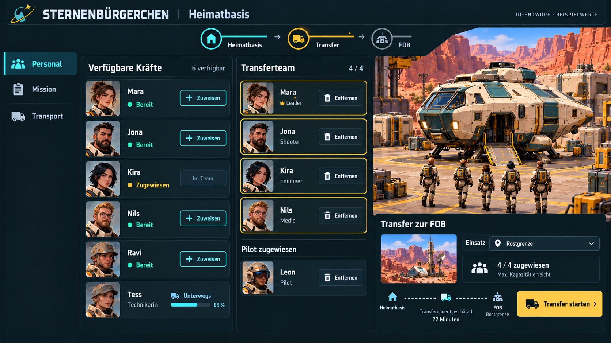 | 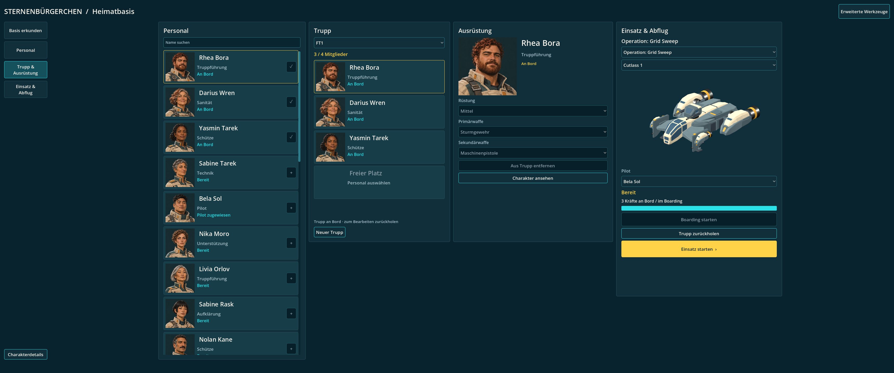 |

Übernommen wurden die klare linke Navigation, große Personenporträts, erkennbare
Rollen und Zustände sowie die räumliche Trennung von Personen, Trupp und Abflug.
Die vier Plätze zeigen die echte Belegung: Im normalen Bootstrap sind drei
Mitglieder an Bord und ein Platz frei. Es wurde kein viertes Mitglied für das
Bild erfunden. Gelb kennzeichnet den ausgewählten Trupp und die Hauptaktion;
Petrol, Cyan und helle Flächen knüpfen an die Vorlage an.

Der sichtbare Abstand bleibt deutlich: Die Vorlage besitzt eine große,
illustrierte Hangarlandschaft und eine dichtere Bildkomposition. Die native
Operationsansicht nutzt eine zentrierte Arbeitsfläche mit mehr freiem Raum und
einer separaten Schiffsvorschau. Eine durchgehende malerische Hangarbühne hinter
allen Panels ist nicht umgesetzt. Die technische Lesbarkeit ersetzt kein
gestalterisches Nutzerurteil.

### Trupp und Ausrüstung: Fokusperson und Schiff

| Originales 2D-Ziel | Native Trupp-/Ausrüstungsansicht |
|---|---|
| 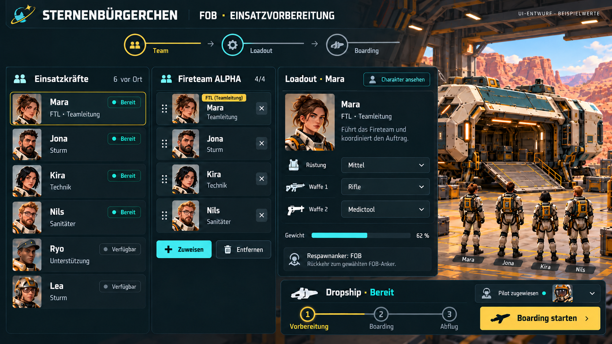 |  |

Die neue Ansicht macht die gewählte Person zum klaren Bezugspunkt für die drei
Loadoutfelder. Das quadratische Porträt erhält Stirn und Augen vollständig;
die frühere breite Bannerbeschneidung ist in diesem Kandidaten korrigiert.
Die native Ref03-Cutlass-Vorschau ersetzt das kleine Sprite. Pilot, Belegung,
Boarding und Start stehen gemeinsam im rechten Bereich. Besetzte oder laufende
Transporte werden durch die bestehenden Busy-Gates begrenzt; andere verfügbare
Trupps lassen sich weiter bearbeiten.

Die reale Cutlass hat eine andere Geometrie als das große Konzeptdropship.
Auch fehlen die vier inszenierten Figuren vor dessen Rampe und die warme
Hangarbeleuchtung der Illustration. Die neue Oberfläche erfüllt die gewünschte
Bedienreihenfolge, erreicht aber noch nicht deren gesamte szenische Wirkung.

Die begehbare Basis ist zusätzlich über die Navigation erreichbar:

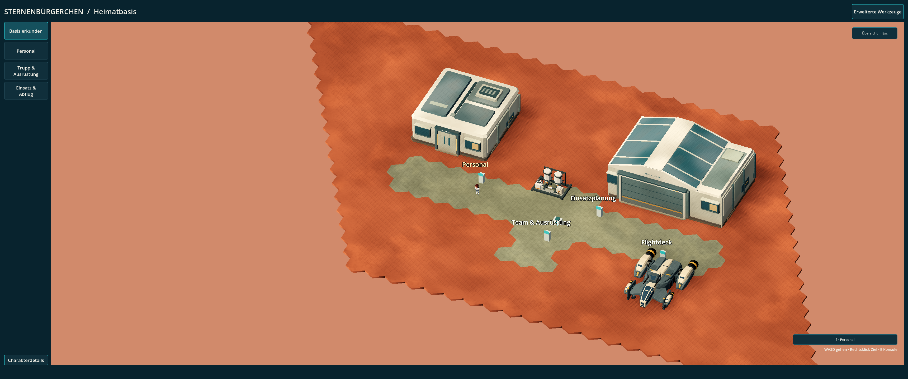

Der [86/86-Lauf](../qa/playtest_20261105/native_base_controls/controls.json)
prüft Bewegung, Rückkehr zur Operationsansicht und den normalen Einsatzweg.
Das [Rohlog](../qa/playtest_20261105/native_base_controls/playtest_20261105_native_homebase_capture.log)
enthält vier überflüssige `mouse_notify`-Warnungen des damaligen Harnesses.
Diese Testaufrufe wurden anschließend entfernt. Der historische Beleg bleibt
unverändert; ein späterer Lauf muss den bereinigten Stand separat belegen.

### Schmale Ansichten: ursprünglichen RED korrigiert

Die erste logische 1280er Homebaseaufnahme aus
`native_logical_sizes/20261105T085433Z-a588f435` zeigte zerlegte Namen und Rollen.
Sie bleibt mit SHA als **ersetzter RED-Beleg** im
[externen Index](../qa/playtest_20261105/external_index.md) erhalten. Die dortigen
77/77-Missionschecks sind kein Beleg für die damalige Homebase-Lesbarkeit.

Die neue [native Responsive-Serie mit 19/19](../qa/playtest_20261105/responsive_final/layouts.json)
prüft logisch 1280×720, 1600×900 und 1920×1080 auf dem physischen
2560×1440-Vollbilddisplay. Bei 1280 zeigt Trupp & Ausrüstung drei Spalten;
Einsatz & Abflug bleibt über die sichtbare Navigation erreichbar. Ab 1600
bleiben vier Spalten. Lange Namen werden mit Auslassungspunkten gekürzt und
bleiben als Tooltip vollständig lesbar; Rollen und Status stehen einzeilig.
Die gemessene Namensbreite beträgt 116 px bei 1280, 106 px bei 1600 und
183 px bei 1920. Der [erweiterte Headless-Verifier](../qa/playtest_20261105/final_followups/homebase_narrow_green.log)
besteht 62/62 einschließlich der bisherigen Gates und Ownererhalt beim Navigieren.

| Neue schmale Basis, logisch 1280 | Vier Spalten, logisch 1600 |
|---|---|
| 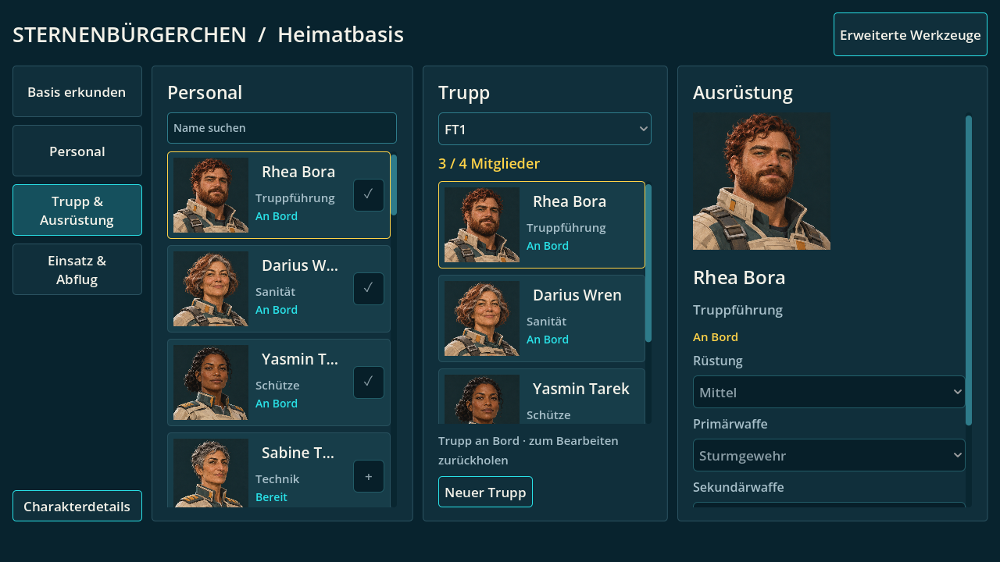 | 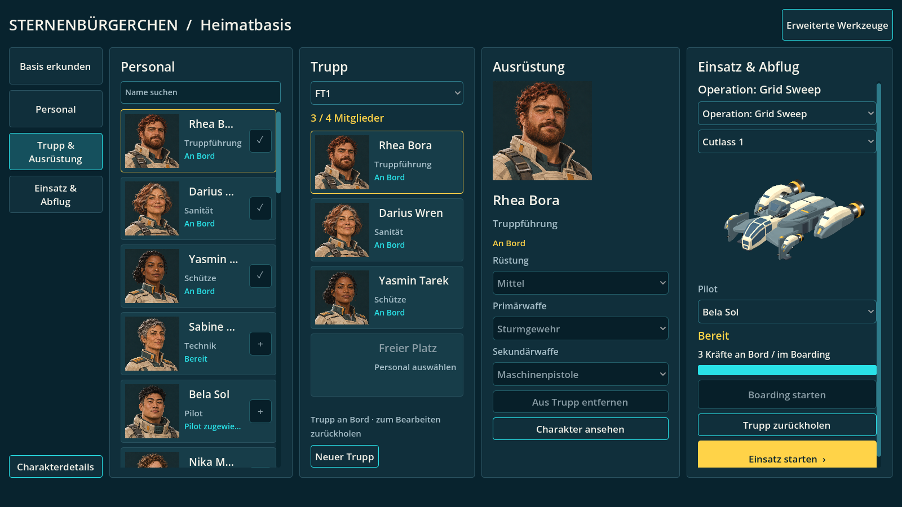 |

Die Bilder wurden geöffnet und direkt geprüft. Schmale Namen sind teils gekürzt,
aber nicht mehr buchstabenweise gestapelt. Die 1600er Ansicht bleibt eng; die
1920er Ansicht hat mehr Textbreite. Das ist ein bestätigter Layoutnachweis,
keine stilistische Nutzerabnahme.

### A5-Missionsziel: kompakte Führung um eine freie Karte

| Originales 2D-Ziel | Native Mission |
|---|---|
| 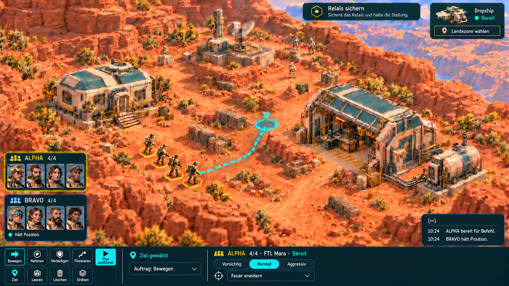 | 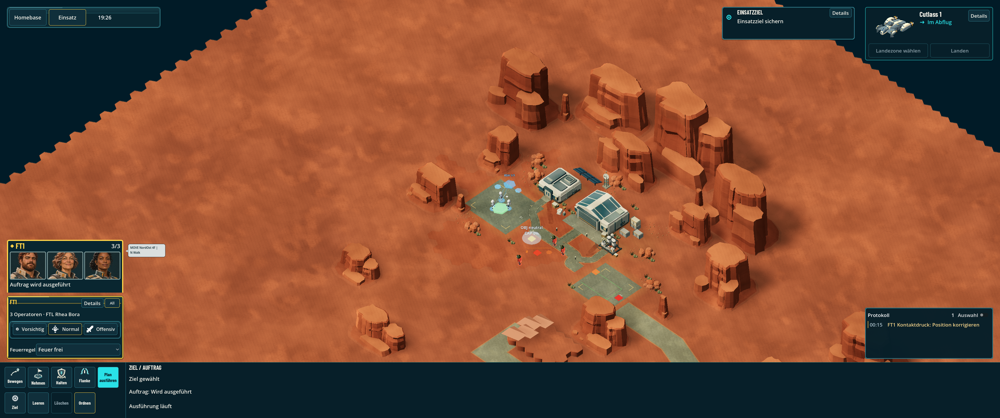 |

Das Missions-HUD orientiert sich an der klaren Randbelegung: Fireteam links,
Einsatzziel und kompakte Transportkarte oben rechts, Protokoll unten rechts und
Befehle unten links. Seltene Informationen liegen hinter Details. Porträts im
Team entsprechen den Identitäten aus der Heimatbasis. Das Ziel-/Auftragsfeld
bleibt mit der bestehenden Befehlsausführung verbunden.

Die native Kamera ist in dieser Aufnahme weiter entfernt als in der Vorlage.
Figuren und Gebäudeteile wirken deshalb kleiner. Die echte Welt besitzt einen
reduzierteren, facettierten 3D-Stil und weniger malerische Detaildichte; große
ruhige Bodenflächen sind sichtbar. Native Tests zur Lesbarkeit und zum
Clipping sind ein eigener Nachweis, keine Abnahme dieser Stilunterschiede.

Die [Mission in zwei zusätzlichen logischen Größen](../qa/playtest_20261105/mission_logical_sizes/report.json)
bestand je 77/77 bei 1280×720 und 1920×1080. Das physische Display blieb
2560×1440; diese Tests sind kein erneuter physischer 3440er Lauf.

## Porträts und wiederhergestelltes Hauptmenü

Alle **42 bestehenden Porträt-IDs und ihre Tags** sind erhalten. Elf neue
zusammengehörige Viererbögen liefern **44 Gesichter**, davon zwei Reserven.
Jeder 1254×1254-Bogen bleibt als Original erhalten; vier exakte 627×627-
Atlasregionen laden die Einzelporträts ohne Rasterbearbeitung oder Resampling.
Der gemeinsame Stil verwendet warme Hauttöne, helle Arbeitskleidung und
Petrolhintergründe. Gesichter unterscheiden sich in Alter, Haaren, Gesichtsform
und Ausstattung.

Das [Porträtmanifest](../qa/playtest_20261105/portraits/provenance/manifest.json)
enthält Zuordnung, Prompts, Originalausgaben, Quellenhashes und das Sichturteil
aller elf tatsächlich geöffneten Bögen. Die historischen Manifestfelder mit
`pending_root` bleiben als Entstehungsstand erhalten. Root hat den anschließenden
Import ohne Diagnostik sowie Atlas- und Legacykatalog-Gates bestätigt; die native
Operationsansicht zeigt die Integration. Die stilistische Nutzerabnahme ist offen.
Legacy-Pfade werden über den Katalog gelesen; bestehende Saves und Profile wurden
für die Porträtumstellung nicht umgeschrieben.

Das [ursprüngliche TASK199-Hauptmenübild](../../Assets/curated/main_menu/sternenbuerger_main_menu_bg.jpeg)
ist exakt wieder aktiv. Sein SHA-256 lautet
`8702c2e3989b8e537656bf3824c734e2474ba797f7744b574aad8390299a5563`.
Die [native Hauptmenüaufnahme](../qa/playtest_20261105/native_base_controls/controls_captures/01_main_menu.png)
belegt den normalen Start mit diesem Hintergrund. Das ist eine Wiederherstellung
des Originalassets, kein neu generierter Ersatz.

## Reale Flugfolge und getrennte NPC-Visualfixture

Der [77/77-Lauf](../qa/playtest_20261105/native_visual_3440/visual.json) hat
Abstieg, Bodenkontakt und Start im normalen timergetriebenen Transferpfad
beobachtet. Es gab keine erzwungene Ankunft, Entladung, Zeitbeschleunigung oder
privaten Runtime-Statewrites. Die nachfolgenden Bilder stammen aus dieser Folge.

| Abstieg | Bodenkontakt | Start |
|---|---|---|
| 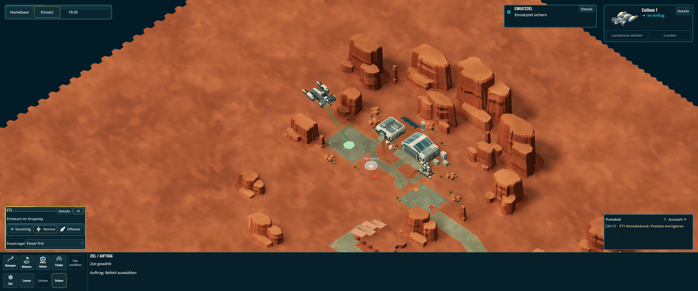 |  |  |

Im **normalen 20-Sekunden-Beobachtungsfenster wurde kein neues sichtbares reales
Waffenereignis beobachtet** (`observed: false`). Der Lauf erzeugte keines.
Er beweist daher keinen natürlichen Schusswechsel und keine physische
Combatabnahme.

Für die Sichtbarkeit von Down/Bleedout, Heilung, Respawn und zeitlich begrenztem
Schussfeedback gibt es eine ausdrücklich **kontrollierte private Visualfixture**:
[23/23 Basischecks und 19/19 Capturechecks](../qa/playtest_20261105/npc_controlled_fixture/npc_visual_fixture_2677746.json).
Zustände werden dort über bestehende Owneraufrufe gesetzt und der Waffenpayload
ist synthetisch. Keine Produktänderung wurde für die Fixture vorgenommen.
Die identische ursprüngliche Modellinstanz bleibt während der Zustandsfolge
erhalten. Flash/Glyph sind in den frühen Aufnahmen sichtbar und später abgelaufen.

| Kontrolliertes Down mit Originalfigur | Synthetisches Waffenfeedback |
|---|---|
| 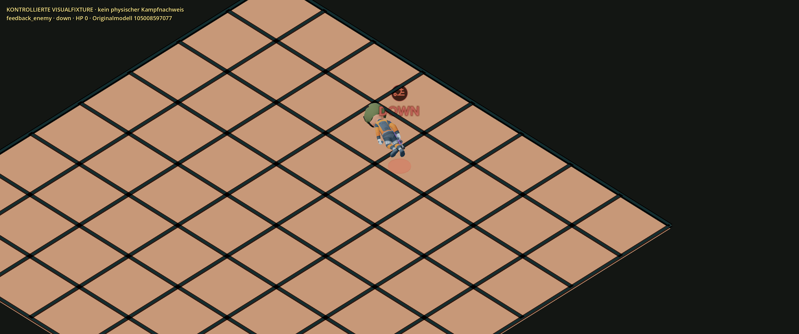 | 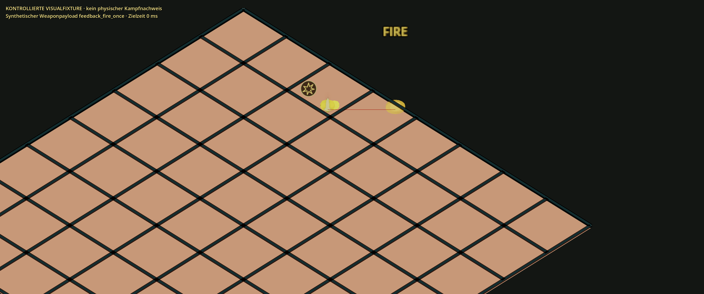 |

Diese Bilder belegen die Darstellung unter kontrollierten Bedingungen.
Sie belegen keinen natürlich entstandenen Treffer, Bleedout oder Respawn im
regulären Spiel und keinen Mehrspielerkampf.

## Performance: aktives Frühfenster und fortgesetzter Bewegungsnachtest

Der [Rohvergleich](../qa/playtest_20261105/performance/before_token_fix/active_0_30_comparison.json)
stellt die aktiven ersten 0–30 Sekunden der beiden 1×-Läufe gegenüber. Beide
führten elf registrierte Units und denselben Move-/Go-Zielablauf. Der vollständige
spätere 90-Sekunden-Lauf stoppte ab etwa Sekunde 35 aufgrund eines anschließend
bestätigten Move-Token-Bugs. Seine späte Ruhephase darf nicht als flüssige aktive
Simulation oder finale FPS-Abnahme verwendet werden.

| Messgröße, aktives Frühfenster | Vorher | Nach Optimierung, vor Tokenfix |
|---|---:|---:|
| Erfasste Dauer | 29,904 s | 29,999 s |
| Frames | 104 | 971 |
| Mittlere Frametime | 287,536 ms | 30,895 ms |
| p50 / p90 | 161,998 / 1028,225 ms | 28,444 / 51,063 ms |
| p95 / p99 | 1058,001 / 1112,969 ms | 64,717 / 135,441 ms |
| Maximum | 1138,314 ms | 297,676 ms |
| Hitches über 100 / 250 ms | 100 / 16 | 21 / 2 |
| Simulationssekunden je Wandsekunde | 0,460 | 0,988 |
| Maximal wartende Navigation | 0 | 0 |

Das frühe Fenster zeigt deutlich weniger Stillstandszeit. Es enthält weiter
Hitches und ist kein allgemeiner FPS-Wert für das gesamte Spiel. Die
Optimierungen bündeln wiederkehrende Sicherheitsprojektion, verwenden einen
räumlichen Registryindex und vermeiden vollständige Meta-/UI-Planarbeit bei
reinen Transportänderungen. Der versteckte Homebase-Presenter bleibt still.
Autoritative Simulation und fachliche Transferverarbeitung werden weiter bedient.

Der anschließend reproduzierte Tokenfehler ist im
[RED-Beleg](../qa/playtest_20261105/red/empty_token/report.json) erhalten.
Der Corefix betrifft acht Zeilen in zwei `SimulationRoot`-Funktionen, SHA-256
`6d42caddf414f2e303ad34b66447fcd54bfe5de170ac058c0b69a4cfd7f940bc`.
Root bestätigt 15/15 gezielte Tokenchecks und TASK501 10/10. Der unabhängige
Produceraudit fand keine P1-/P2-Regression; die vorbestehende Trusted-API-
Replaygrenze bleibt bestehen.

Der [native Nachtest mit 87/87](../qa/playtest_20261105/move_autodefend_green/move_autodefend.json)
zeigt dieselben drei Units nach Auto-DEF wieder physisch in Bewegung, mit neuen
Tokens und abgewiesenen alten Tokens. Es wurden keine Positionen, Actorwerte
oder Timer zum Herstellen dieses Ergebnisses verändert. Die fortgesetzte
90-Sekunden-Motion-/Performanceprüfung nach dem Fix liegt inzwischen vor.

### Fortgesetzte Bewegung nach dem Fix, physisch 2560×1440

Der [normale 61/61-Lauf](../qa/playtest_20261105/performance/final_motion_90/final.json)
und die [kompakte Analyse](../qa/playtest_20261105/performance/final_motion_90/final_motion_analysis.json)
belegen 90,037 Sekunden bei 1× mit 3869 Frames. Alle drei freundlichen Units
bleiben fit und bewegen sich auch nach Sekunde 35 bis zur letzten Positionsprobe
bei 89,85 Sekunden. Die Simulation erreicht 0,984 Simulationssekunden je
Wandsekunde. Es gab keine erzwungenen Ankünfte, Zeitbeschleunigung oder privaten
Statewrites. Tatsächliche Positionen wurden unabhängig von den sieben
akzeptierten Move-/Go-Aufrufen ausgewertet.

| Messgröße im vollständigen Nachtest | Ergebnis |
|---|---:|
| Mittlere Frametime | 23,268 ms |
| p50 / p95 / p99 | 17,308 / 54,207 / 111,590 ms |
| Maximum | 391,848 ms |
| Hitches über 100 / 250 ms | 56 / 7 |
| Navigations-Backlog | 0 |
| Letzte Positionsprobe | 89,850 s |

Alle sieben Hitches über 250 ms korrelieren mit den synchronen Move-/Go-Aufrufen,
die zusammen etwa 212–331 ms kosten. **Diese Klickkosten bleiben offen.** Nicht
gemessene Restzeit wird keiner Ursache zugeschrieben; ein GPU-Frametimer war
nicht verfügbar. Positionen sind ungefähr mit 4 Hz abgetastet, kein vollständiges
physikalisches Weglängenprotokoll.

Dieser Lauf verwendet physisch und als Renderbuffer 2560×1440. Er belegt
fortgesetzte Aktivität nach dem Corefix, ist aber wegen des Displaywechsels
kein direktes Vorher-/Nachherpaar zur früheren 3440×1440-Messung und keine
allgemeine FPS-Freigabe. Große Frame-/Motion-Rohdateien bleiben unverändert
extern gehasht; Normalbericht, Analyse und Log sind im schlanken Paket.
Die Analyse nennt den verifizierten Corehash, weist aber ausdrücklich darauf
hin, dass die ausgewählte per-Run-Sourceliste `SimulationRoot` nicht enthält.
Der finale Multiplayer-Sourcepin enthält zusätzlich denselben Corehash;
beim abschließenden Paarlauf blieb die vollständige Sourceliste stabil.

## Multiplayer: lokaler nativer Paarlauf bestanden

Zwei unabhängige Sourceprozesse verwenden private Userverzeichnisse und dieselbe
gehashte GM01. Sie gehen über Host/Join, Lobby und Mission bis zum akzeptierten
Abwurf. Der geschützte normale Roster bleibt unverändert. Das ist lokaler
Loopback auf einem Rechner, kein LAN-/WAN- oder Mehrrechnernachweis.

| Erhaltener Versuch | Netzwerk / Drop | Fenster / Ende | Gesamturteil |
|---|---|---|---|
| [Erster Console-Aufruf](../qa/playtest_20261105/multiplayer/first_console_attempt/report.json) | Beide `first_decision_accepted`, 2 verbunden / 2 bereit, identische acht deployed IDs, embarked leer, GM01-Hash gleich | Keine dem überwachten Prozess zugeordneten Fenster; Deadlinecleanup nur eigener PIDs | **FAIL** |
| [GUI-Wiederholung 2](../qa/playtest_20261105/multiplayer/gui_retry_2/report.json) | Netzwerk und Drop erneut konvergent, Sourcepins stabil | WM_CLOSE / Exit 0 für beide; 2560×1442 am 2560×1440-Display statt Vollbild; Client-Cleanup mit ObjectDB-/Resource-/Netfox-Diagnostik | **FAIL** |
| [Vollbild-Retry 3](../qa/playtest_20261105/multiplayer/gui_retry_3/report.json) | Kein erfolgreicher Netzwerkabschluss | Gefordertes 3440-Display inzwischen nicht vorhanden; Prozesse vor dem Netzwerk-Gate beendet, Diagnostik erhalten | **FAIL** |
| [Retry 4, extern erhalten](../qa/playtest_20261105/external_index.md) | Netzwerk konvergent und native Captureprüfung bestanden | Vollbild-/Diagnostikgate weiterhin fehlgeschlagen, vor abschließendem Clockfix | **FAIL** |
| [Finaler Paarlauf](../qa/playtest_20261105/multiplayer/final_pair/report.json) | Beide `first_decision_accepted`, jeweils 2 verbunden / 2 bereit, identische acht deployed IDs, embarked leer, GM01-Hash gleich | Beide Rootfenster nativ vollflächig; Display, Renderbuffer und PNG 2560×1440; regulärer Probe-Exit 0; Enginefehler 0 | **PASS, 10/10** |

Die Ursache des zweiten Fensterfehlers ist belegt: Die frischen Menüsettings
überschreiben den CLI-Vollbildwunsch mit dem Fensterstandard. Retry 3 mit privater
Vollbildpräferenz und Monitorwahl scheiterte korrekt am inzwischen fehlenden
3440-Display. Auch Retry 4 bleibt mit seinem ursprünglichen FAIL erhalten.
Die Harnesskorrekturen ändern keine Gameplaywerte. Alle vier Fehlversuche
bleiben mit unveränderten Reports, Sourcepins und Logs erhalten; vorhandene
Traces bleiben ebenfalls erhalten.

Ein separater [Owner-Nachtest mit 16/16](../qa/playtest_20261105/multiplayer/clock_owner_green/report.json)
bestätigt die Korrektur der lokalen Netfox-Uhr beim Disconnect und beim
Hostwechsel im selben Frame. Ein fremder Session-Owner stoppt die Root-Uhr
weiterhin nicht; der eigene Disconnect stoppt seine Uhr und bleibt wiederholbar.
Das ist ein gezielter Ownerbeleg. Der abschließende Paarlauf bestätigt zusätzlich
Netzwerk, Abwurf, native Darstellung und reguläres Ende. Seine
[Sourcepins](../qa/playtest_20261105/multiplayer/final_pair/source_pins_before.json)
blieben stabil. Der Session-SHA lautet
`6391d67b81de66747df15daaa6b66cbcb121e654b777dba7cf517b99239deafd`,
der Corehash bleibt `6d42caddf414f2e303ad34b66447fcd54bfe5de170ac058c0b69a4cfd7f940bc`.
Root bestätigt das unabhängige Review beider Korrekturen.

| Nativer Host | Nativer Client |
|---|---|
| 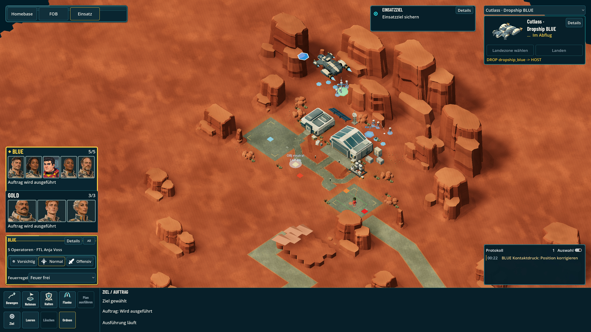 | 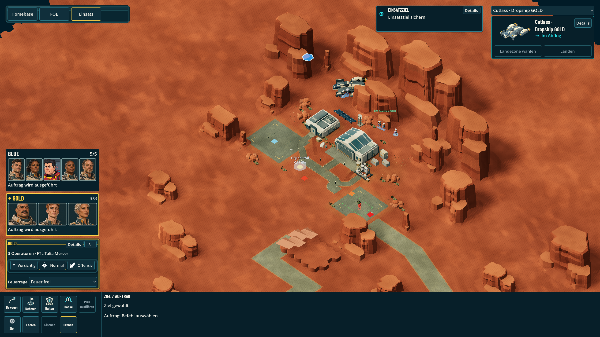 |

Win32 meldet bei beiden Fenstern zwei zusätzliche Pixel am unteren Rand
(2560×1442); dieser Overscan bleibt ausdrücklich im Report erhalten. Die
native Probe bestätigt Fenstermodus, Display, Viewport und PNG exakt mit
2560×1440. Das ist keine stillschweigende Umdeutung des vorherigen Fehlversuchs:
Der finale Nachweis kombiniert die Win32-Geometrie mit der nativen Probe.

Beide Engine-Errorzähler stehen auf 0. Die Rohlogs enthalten weiterhin
Netfox-Debugmeldungen `Game stalled ... assuming it was a pause`, beim Host
bis 2,755 s. Der grüne Paarlauf ist deshalb kein allgemeiner Nachweis für
ruckelfreie Synchronisation. Die historischen Clock-/Shutdown-Warnungen aus
den Fehlversuchen bleiben unverändert erhalten.

Das begrenzte gemeinsame Maplimit wurde für GM01 auf 4 MiB angehoben; der
gezielte Nachtest ist 7/7 grün, 4 MiB + 1 bleibt abgelehnt. Consent- und
Hashregeln bleiben erhalten. Ein Netzwerk-Payloadtransport für unbekannte Karten
und ein Buildversions-Handshake werden dadurch nicht nachgewiesen.

## Prüfgrenzen, Review und Abschluss durch Root

Die normalen nativen Routen erzeugten ihren Testroster durch den normalen Start
in privaten Userverzeichnissen. Die Runner dokumentieren den geschützten
normalen Roster separat. Die synthetische NPC-Fixture hat einen anderen Zweck
und ist im Bild sowie in den Rohdaten ausdrücklich gekennzeichnet.

Die [Vorab-REDs](../qa/playtest_20261105/red/) bleiben erhalten. Sieben bereits
gegen Original-Main bestätigte historische Altgates werden getrennt bilanziert:
die sechs zuvor bekannten und TASK468 mit 13 PASS / 1 FAIL. Sie werden nicht
als neue Fehler verkauft. Die [abschließende gezielte Matrix](../qa/playtest_20261105/final_checks/report.json)
besteht 34/34 ausgewählte Gates ohne Enginefehler. Das ist keine Aussage, dass
sämtliche historischen Tests des Projekts grün wären. Das
[unabhängige Source-Review](../qa/playtest_20261105/reviews/independent_review.md)
meldet im beauftragten Registry-/Security-/Meta-/NPC-/Flug-/Hex-/Maplimit-Scope
keine P1-/P2-Befunde. Eigener Homebasecode wurde davon getrennt bewertet.

| Schlussgate | Status dieses Berichts |
|---|---|
| Native Operations-/Basisroute 3440×1440 | 86/86 bestätigt; historische Harnesswarnungen dokumentiert |
| Native Visual-/Flugroute 3440×1440 | 77/77 bestätigt; realer Schuss im Beobachtungsfenster unbeobachtet |
| Kontrollierte NPC-Darstellung | 23/23 + 19/19 bestätigt; synthetisch |
| Move nach Auto-DEF | 87/87 nativ bestätigt |
| Fortgesetzte 90-s-Bewegung nach Corefix | 61/61; 2560×1440, Bewegung bis 89,85 s; Klickhitches bleiben offen |
| Native weitere logische UI-Größen | Responsive 19/19; Mission je 77/77; Headless 62/62 |
| Clock-/Disconnect-Ownerregression | 16/16; gezieltes Gate, keine Paarlaufabnahme |
| Multiplayer-GUI-Vollbild und sauberer Disconnect | PASS, alle 10 Checks; Loopback, zwei Sourceprozesse |
| Finale Sourcepins und gezielte Nachbarmatrix | Stabil; 34/34 ausgewählte Gates, Enginefehler 0; sieben Altgates separat |
| Main-Integration / Push | **PENDING Root** |
| Smoke nach Main-Integration | **PENDING Root** |
| Stilistische Nutzerabnahme | **OFFEN** |
| EXE / Paket / Release; LAN / WAN / Mehrrechner | **Nicht nachgewiesen** |

Root ergänzt nach Main-Integration den Commitstand und den anschließenden Smoke.
Bis dahin bleibt die Integration offen; die oben belegten Teilresultate bleiben
an ihre dokumentierten Quellen und Laufbedingungen gebunden.

Vertragliche Basis: [Haupttask](../tasks/PLAYTEST_2026_11_05_fullscreen_ux_visuals.md),
[Grafikreferenzvertrag](../dev/graphics_reference_revision_contract.md) und die
dort verlinkten Owner-, UX-, Combat- und Multiplayerverträge.
