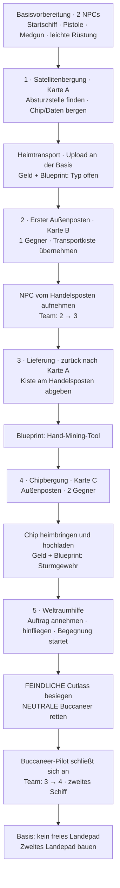

# Kampagnenplan: die ersten fünf Missionen

Stand: 10.11.2026. Nutzerauftrag: Ablauf mit fünf Missionen, grafischem Baum und offenen Punkten festhalten. **Zielplanung, keine implementierte oder spielerisch abgenommene Kampagne.**

**Folgeauftrag:** Die Umsetzung wurde anschließend vom Nutzer beauftragt.
Aktueller Arbeitsstand und Prüfbelege: [Umbau-Arbeitsplan](CAMPAIGN_SKIRMISH_REBUILD_2026_11_10.md).
Die nachfolgenden Doku-Grenzen beschreiben den ursprünglichen Planungsauftrag.

## Ziel / Problem und Sinnhaftigkeit

Eine zusammenhängende erste Kampagnenfolge vermittelt Vorbereitung, Erkundung,
Bergung, Heimtransport, leichten Bodenkampf, Handel, Personalzuwachs und schließlich
Raumkampf und Basisausbau. Der bisherige Einführungsablauf deckt diese Folge nicht ab.
Die Wiederkehr zur Satellitenkarte macht Orte auch nach ihrem ersten Auftrag relevant.

## Arbeitsbasis und Umfang

Eigener Dokumentationsbranch `task/campaign-five-missions-plan-20261110` auf
`e765f507c`, bewusst vom noch nicht integrierten Taskstand
`task/map-save-building-migration-20261110` abgeleitet. Der alte Integrationsbranch
`integration/core-foundation` enthält den hier untersuchten aktuellen Ortsstand nicht.
Vorhandene fremde Änderungen bleiben erhalten und gehören nicht zu diesem Plan.

Umfang: fünf Aufträge, drei große Bodenkarten, ein Weltraumschauplatz sowie
Basisvorbereitung und Ausbau als begleitende Fortschrittsschritte. Keine Änderung
an Produktcode, Karten, Balancing, Saveformat, Assets oder bestehenden Runtime-Contracts.
Kein Implementierungsauftrag für weitere Missionen, Multiplayer oder parallele Ortsinstanzen.

## Festgehaltener Basistart

- Genau zwei echte NPCs und ein Startschiff. Der im gesprochenen Auftrag als
  „Thermisser“ bezeichnete Schiffsname/-typ bleibt zu klären.
- Startausrüstung: Pistole, Medgun und leichte Rüstung. Exakte Mengen bleiben offen.
- Ausrüstung soll als erkennbare Gegenstände sichtbar sein und per Drag-and-drop
  auf die Figur beziehungsweise passende Ausrüstungsslots gezogen werden können.
- Weitere sichtbare Rüstungsbeispiele werden benötigt; Typen und Umfang sind offen.
- Personen sollen benannt beziehungsweise später umbenannt werden können.
- Basisvorbereitung zählt nicht als eine der fünf Missionen.

## Grafischer Kampagnenbaum

Der Hauptpfad ist zunächst linear; Rohstoffsuche ist ein begleitender Besuchsgrund.

## Die fünf Missionen

| Nr. | Auftrag / Ort | Handlungen und Ziel | Belohnung / Fortschritt |
| --- | --- | --- | --- |
| 1 | Satellitenbergung, Karte A | Absturzstelle in großer Landschaft suchen, erreichen, Chip/Daten aufnehmen und tatsächlich nach Hause bringen; an der Basis hochladen. Kein früher Kampf gefordert. | Geld und ein noch unbestimmter Blueprint. |
| 2 | Erster Außenposten, Karte B | Außenposten mit nur einem Gegner bewältigen; bewusst sehr leichter erster Kampf. Transportkiste übernehmen. Am räumlich getrennten Handelsposten einen NPC aufnehmen. | Team wächst von zwei auf drei; Fracht und Lieferfolgeauftrag. Weitere Belohnung offen. |
| 3 | Lieferung, erneut Karte A | Fracht von Karte B zum Handelsposten auf der Satellitenkarte bringen und abgeben. | Blueprint für ein Hand-Mining-Tool. |
| 4 | Weitere Chipbergung, Karte C | Außenposten mit zwei feindlichen Gegnern bewältigen; Chip bergen, heimtransportieren und an der Basis hochladen. | Blueprint für ein Sturmgewehr und Geld. |
| 5 | Hilfe im Weltraum | Auftrag annehmen und zum Schauplatz fliegen. Bei Ankunft beginnt die Begegnung. **Cutlass ist feindlich, Buccaneer neutral.** Feindliche Cutlass besiegen. | Pilot der geretteten Buccaneer tritt bei; Team wächst von drei auf vier. Zweites Schiff führt zum Bedarf für das zweite Landepad. |

Mission 3 ist als eigener Lieferauftrag gezählt, obwohl sie dieselbe Karte wie
Mission 1 verwendet. Ob zwischen Mission 2 und 3 eine zusätzliche Heimkehr liegt,
ist noch offen. Der Padbau ist ein Ausbauziel nach Mission 5, keine sechste Mission.
„Sehr leicht“ bei Mission 2 ist ein gewünschtes Spielergebnis, keine technisch
belegte Siegsgarantie; Gegnerwerte und Hilfe müssen später passend geprüft werden.

## Karten und Rohstoffe

| Karte | Gewünschte Landschaft / Platzierung | Wiederkehrende Inhalte |
| --- | --- | --- |
| A — Satellitenregion | Große, abwechslungsreiche Karte mit Schluchten, Tälern, Felsen und etwa einem ausgetrockneten Flussbett. Absturzstelle irgendwo im Gelände zu suchen. | Satellit, Handelsposten und zwei Rohstoffarten; Rückkehr für Mission 3. |
| B — erster Außenposten | Große andere Karte. Außenposten seitlich versetzt, nicht direkt in einer Ecke; Handelsposten weit entfernt in einem anderen Bereich. | Ein Gegner am Außenposten, rekrutierbarer NPC am Handelsposten, Fracht und dazwischen zwei Rohstoffarten. |
| C — weiterer Außenposten | Dritte große Bodenkarte mit Außenposten. Weitere Landschaftsdetails offen. | Zwei Gegner und bergbarer Chip. Handel und Rohstoffverteilung hier noch nicht festgelegt. |

Vorläufig einheitliche Rohstoffnamen: **A-Benit, B-Benit und C-Benit**.
Auf den beiden Handelskarten sollen jeweils zwei Arten vorkommen, die der jeweilige
lokale Händler nicht ankauft. Die konkrete Verteilung und Ankaufsmatrix sind offen.
Die Kiste aus Mission 2 könnte C-Benit oder ein Derivat aus A-/C-Benit enthalten;
das sind ausdrücklich Alternativen, noch keine festgelegte Rezeptur.

## Übergreifende Zielregeln und Abhängigkeiten

- Bergbare Auftragschips müssen physisch zur Heimatbasis gebracht und dort an
  einer noch zu bestimmenden Uploadstation verarbeitet werden. Aufnehmen allein
  schließt diese Aufträge nicht ab. Geld und Blueprints folgen dem bestätigten Abschluss.
- Der genaue Sinn des gesprochenen „Termin“-Teils ist unklar; Upload am Basisterminal
  ist die vorläufige Lesart, kein zusätzlicher bestätigter Terminmechanismus.
- Mining wird erst mit Mission 3 als Blueprint freigeschaltet. Die Pflichtziele
  vorher dürfen deshalb kein noch nicht verfügbares Miningwerkzeug verlangen.
- Ressourcen finden und Ressourcen abbauen sind getrennte Schritte. Erforderliche
  Herstellung des Tools nach Blueprint-Erhalt ist noch zu entscheiden.
- Personalzuwachs: 2 → 3 am Handelsposten von Karte B → 4 durch den Buccaneer-Piloten.
- Fehlendes Pad braucht eine verständliche Meldung und erreichbaren Ausbauweg.
  **Vorschlag, noch offen:** Buccaneer wartet im Orbit, bis Pad 2 fertig ist.
- Die erste Mission soll Erkundung verlangen. **Vorschlag, noch offen:** Ping zeigt
  einen groben Suchbereich; die genaue Stelle wird vor Ort entdeckt.
- Fortschritt, Fracht, Personal, Flotte und Belohnungen müssen bei späterer Umsetzung
  über vorhandene autoritative Owner/Commands laufen, nicht über UI-Ersatzzustände.

## Offene Punkte vor Umsetzung

| Thema | Noch zu entscheiden / gegen Bestand zu prüfen |
| --- | --- |
| Startschiff | Was genau bezeichnet „Thermisser“? Nicht automatisch als Cutlass festlegen. |
| Startinventar | Mengen, Zuordnung zu den beiden Personen, weitere Rüstungstypen und sichtbare Beispiele; Drag-Ziele und alternative Klickbedienung. |
| Erster Blueprint | Welcher Blueprint kommt aus Mission 1? |
| Suche / Ping | Existiert ein nutzbarer Such-Ping? Aktueller Suchlauf bestätigt ihn nicht. Radius, Kosten, Wiederholung und Suchhilfen offen. |
| Kartengröße | Konkrete Abmessungen, Lauf-/Flugzeiten, Landmarken und Performancebudget; „groß“ ist noch kein messbarer Inhaltstest. |
| Rohstoffe / Handel | Verteilung der drei Benitarten, Mengen, Ankaufsmatrix, Preise und Wiederbesuche. |
| Lieferkiste | C-Benit oder Derivat; Menge, Übernahmeort, Transportkapazität und Abgabeinteraktion. |
| Miningfreischaltung | Blueprint allein oder zusätzlich Werkzeugfertigung? Aktueller Ortsressourcen-Slice sieht bereits Startwerkzeuge vor; Konflikt vor Umsetzung auflösen. |
| Rekrutierung / Namen | Genaue Interaktion, Boarding, freie Plätze, Startausrüstung und Zeitpunkt der Namensvergabe; Spieler vergibt Namen für NPCs, kein bestätigter Mehrspielerauftrag. |
| Chip / Upload | Physisches Item oder Datencontainer, Uploadstation, Dauer, Wiederholungen und Verlust-/Abbruchverhalten. |
| Raumkampf | Steuerung, Startbedingungen, Sieg/Niederlage, Schutz der neutralen Buccaneer, Pilotentransfer und tatsächliche Schiffsübernahme. Fraktionen sind geklärt. |
| Zweites Pad | Startverfügbarkeit, Baukosten/-zeit/-platz und Warteort der Buccaneer. Aktuelle Ortsdaten führen bereits zwei Pad-IDs; Pad-ID ist noch kein freigeschalteter Bauplatz. |
| Ökonomie / Scheitern | Credits, Blueprintkosten, Fuel und Padbau so abstimmen, dass kein Fortschritts-Sackgassenfall entsteht; Wiederholung ohne doppelte Belohnungen. |
| Speicherung | Neue Meilensteine und Rekruten/Flotte/Fracht in bestehende sichere Basis-Checkpoints einordnen; kein neuer Mid-Mission-Save zugesagt. |

## Bestandsabgleich und relevante Dokumente

Der gelesene `data/singleplayer/jobs.json` enthält bislang nur
`satellite_recovery` mit 150 Credits. Der bestehende Einführungsvertrag beschreibt
Basisvorbereitung → Satellitenbergung → Versorgung mit Kauf/Tanken und Heimkehr.
Dieser Plan ist das neue Kampagnenziel; er macht die zusätzlichen Missionen nicht
zu bereits vorhandenen Funktionen und ändert alte Runtime-Verträge noch nicht.

Relevante Quellen:

- [Projektbrief](../PROJECT_BRIEF.md), [Architektur](../ARCHITECTURE.md),
  [Arbeitsregeln](../CODEX_RULES.md), [Implementierungsstatus](../IMPLEMENTATION_STATUS.md).
- [Bisherige Einführung](../dev/campaign_introduction_contract.md) und
  [bisheriger Startentwurf](CAMPAIGN_START_2026_11_09_DESIGN.md).
- [Playtest-Sammlung](PLAYTEST_2026_11_10_campaign_world_inventory.md).
- [Ortsressourcen-Slice](../dev/location_resource_interaction_contract.md):
  im untersuchten Arbeitsstand noch unversioniert, deshalb keine integrierte Grundlage behauptet.
- [Orbitreise](../dev/orbit_quantum_travel_contract.md).
- [Aufträge](../../data/singleplayer/jobs.json) und [Orte](../../data/singleplayer/locations.json).

## Akzeptanzkriterien für diesen Dokumentationsauftrag

1. Genau fünf Missionen mit Reihenfolge, Orten, Handlungen und Belohnungen beschrieben.
2. Grafischer Baum zeigt Heimtransport/Upload, Personalzuwachs und zweiten Padbau.
3. Cutlass eindeutig feindlich, Buccaneer eindeutig neutral.
4. Bestätigte Vorgaben, Vorschläge, Unklarheiten und heutiger Bestand unterscheidbar.
5. Drei Bodenkarten; Lieferung verwendet Karte A erneut. Vorbereitung und Padbau
   werden nicht als zusätzliche Missionen gezählt.
6. Keine Produktänderungen oder neue Behauptung einer Laufzeit-/Spielabnahme.

## Betroffene Dateien und lokale Prüfung

Dokumentationsdateien dieses Auftrags: dieser Plan sowie kleine Verweise in
`docs/IMPLEMENTATION_STATUS.md` und `docs/TASK_ROADMAP.md`.
Prüfung: Vollständigkeitsabgleich gegen Nutzerablauf/Korrektur, lokale Linkprüfung,
Baum-/Tabellenabgleich und `git diff --check`. Keine Godot-Tests nötig, da keine
Produktänderung; Mermaid-Quelltext ist dokumentiert, native Diagrammansicht nicht geprüft.

## Risiken / nächster Schritt

Der Plan setzt neue Inhalte und mehrere neue Gameplay-Fähigkeiten voraus.
Offene Werte nicht still in bestehende Systeme übernehmen. Vor Implementierung
betroffene Owner und Contracts erneut lesen und die offenen Abhängigkeiten
in kleine konkrete Umsetzungstasks auflösen. Dieser Auftrag hält den Plan fest;
er beauftragt noch keine Gameplay-Implementierung.
